# Digital Forensics - Lab 3 Report
Case ID: ORION-DF-03  
Name: chikhaoui youcef chihab eddine  
Date: October 15, 2026  
Subject: Disk Image Investigation (FAT16 Filesystem Analysis with TSK)  

---

### Introduction
In this lab, we analyzed a forensic raw disk image named ORION_Disk_Image.dd. The objective is to investigate an allegation that project-related files were copied to a removable storage drive. Instead of using Autopsy GUI, I used The Sleuth Kit (TSK) command line tools on Linux (mmls, fsstat, fls, istat, icat, and mactime) to examine the image, recover deleted data, verify file types, and build a timeline.

---

### Step 0: Hash Verification
First, before doing any analysis, I verified the SHA-256 hash of the evidence image against SHA256SUMS.txt to make sure the file was not altered or corrupted.

sha256sum -c SHA256SUMS.txt

Output:
ORION_Disk_Image.dd: OK
Hash: 73bf6ae3904be363b2cd0dc93751e3fc1b8c5cf739fa4720a0994b9e2cf24895

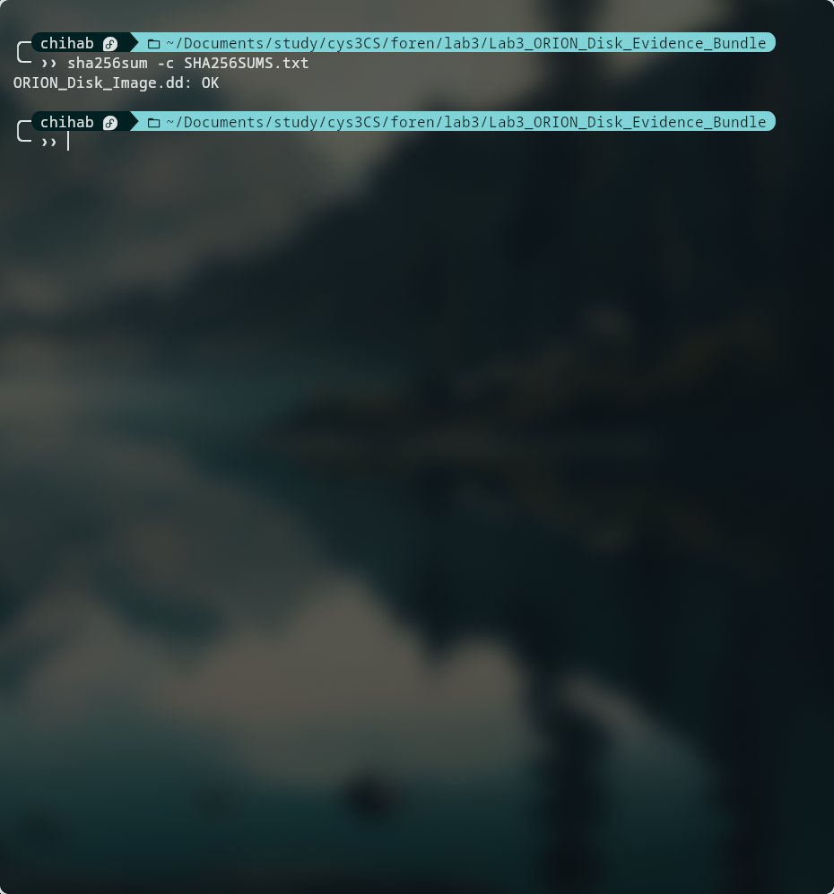

---

### Task A — Identify the Source
I used file and mmls to find the partition table and file system layout:

file ORION_Disk_Image.dd
mmls ORION_Disk_Image.dd

* Image name: ORION_Disk_Image.dd
* Size: 33,554,432 bytes (32 MB, exactly 65,536 sectors of 512 bytes each)
* Partition Scheme: DOS / MBR Partition Table
* Partition offset: Sector 2048 to 67583 (size = 65,536 sectors)
* Partition type: 0x06 (DOS FAT16)

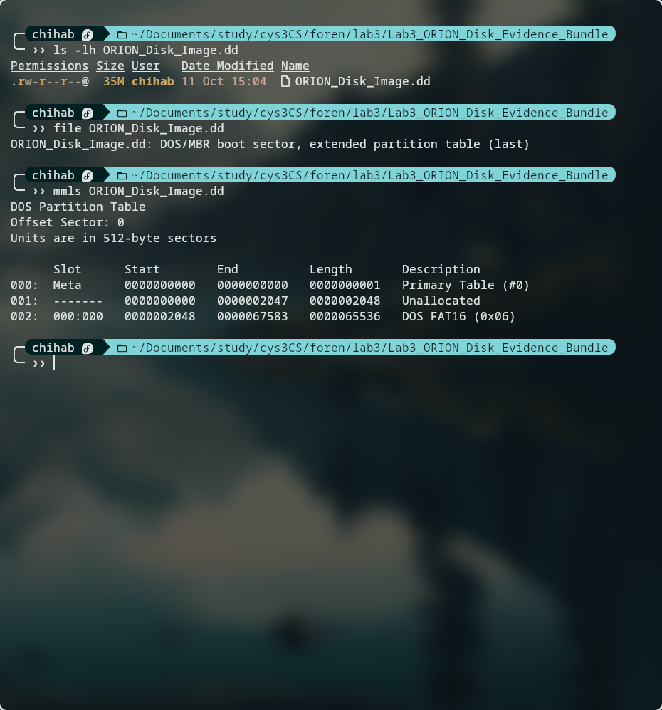

Next, I used fsstat on the partition offset (sector 2048) to get the filesystem details:

fsstat -o 2048 ORION_Disk_Image.dd

* Filesystem: FAT16 (OEM name MSDOS5.0, Volume Label ORIONVOL)
* Sector size / Cluster size: 512 bytes per sector, 1 sector per cluster (512 bytes/cluster)
* Reserved sectors: Sector 0 (Boot Sector)
* FAT tables: 2 copies of FAT (FAT0: 1 to 256, FAT1: 257 to 512)
* Root directory: Sectors 513 to 544 (32 sectors)
* Data area: Sectors 545 to 65535

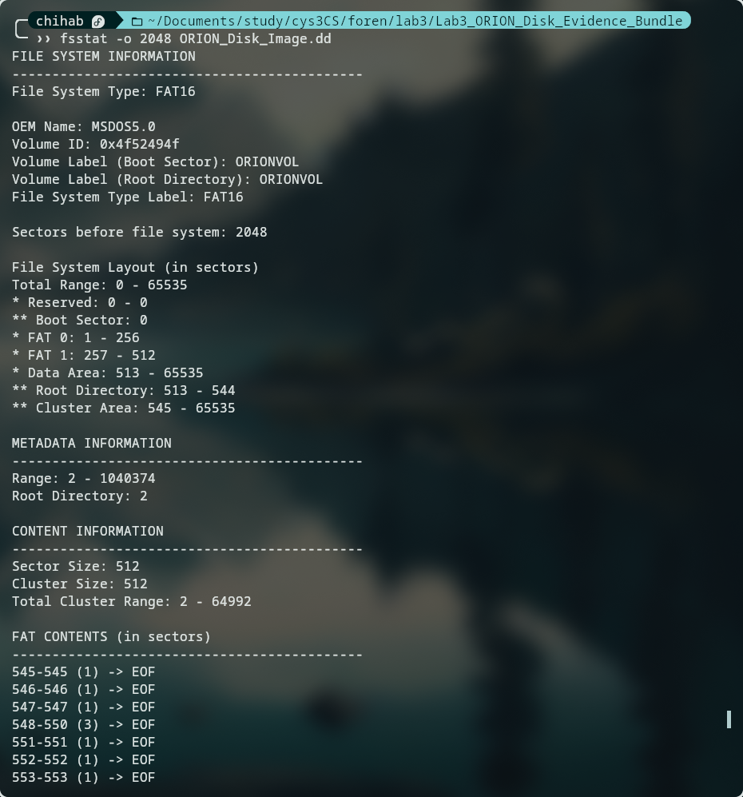

Then, I listed the root directory entries with fls:

fls -o 2048 -p ORION_Disk_Image.dd

Relevant Root Entries:
* Files: README.TXT (inode 4), CASEINFO.TXT (inode 5), ACTIVITY.CSV (inode 6)
* Folders: PROJECTS (inode 7), EVIDENCE (inode 8), USERDOCS (inode 9)

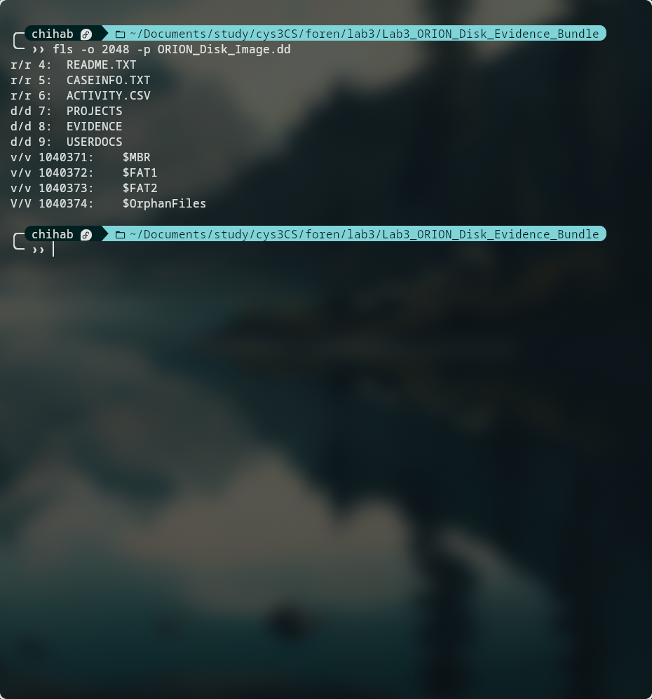

---

### Task B — Examine Relevant Files

#### 1. README.TXT & CASEINFO.TXT
I extracted and read both files using icat:

icat -o 2048 ORION_Disk_Image.dd 4
icat -o 2048 ORION_Disk_Image.dd 5

* README.TXT: Mentions this is an educational training image (ORION-DF-03) with fictional names and timestamps. It tells the investigator: "Do not infer that a file was transferred to USB unless independent evidence supports it."
* CASEINFO.TXT: Gives the scenario that an organization reported a project plan might have been copied to removable storage. The disk image is the only evidence, and we need to report what can be proven and what cannot be proven.

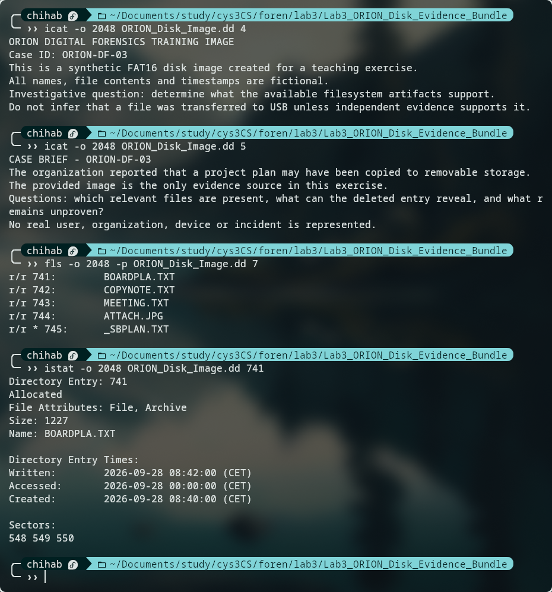

#### 2. Project Files in /PROJECTS
I listed /PROJECTS using fls -o 2048 -p ORION_Disk_Image.dd 7 and examined the files:

* BOARDPLA.TXT (inode 741):
  * Size: 1227 bytes
  * Sectors allocated: 548, 549, 550 (stored across 3 clusters)
  * Timestamps: Created 2026-09-28 08:40:00, Modified 2026-09-28 08:42:00
  * Content: It is a draft project board plan (ORION-PLAN-042). The note inside clearly says: "this document contains no transfer receipt, destination identifier, or USB serial number" and "presence in this image does not establish who placed it here or when it was copied."

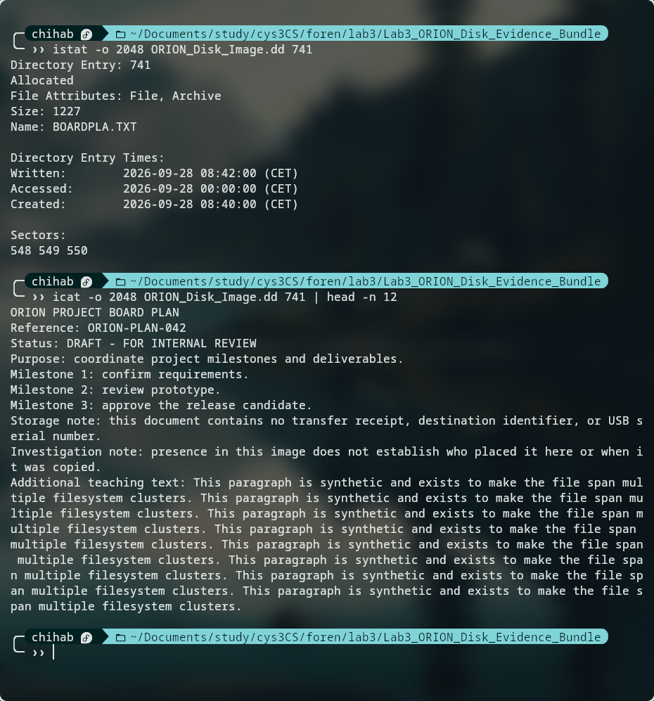

* COPYNOTE.TXT (inode 742):
  * Size: 314 bytes (sector 551)
  * Timestamps: Created 2026-09-28 08:46:00, Modified 2026-09-28 08:47:00
  * Content: Explains that the phrase 'USB copy' is an investigative question, not proof that a copy actually succeeded. There is no USB device serial number or transfer log.

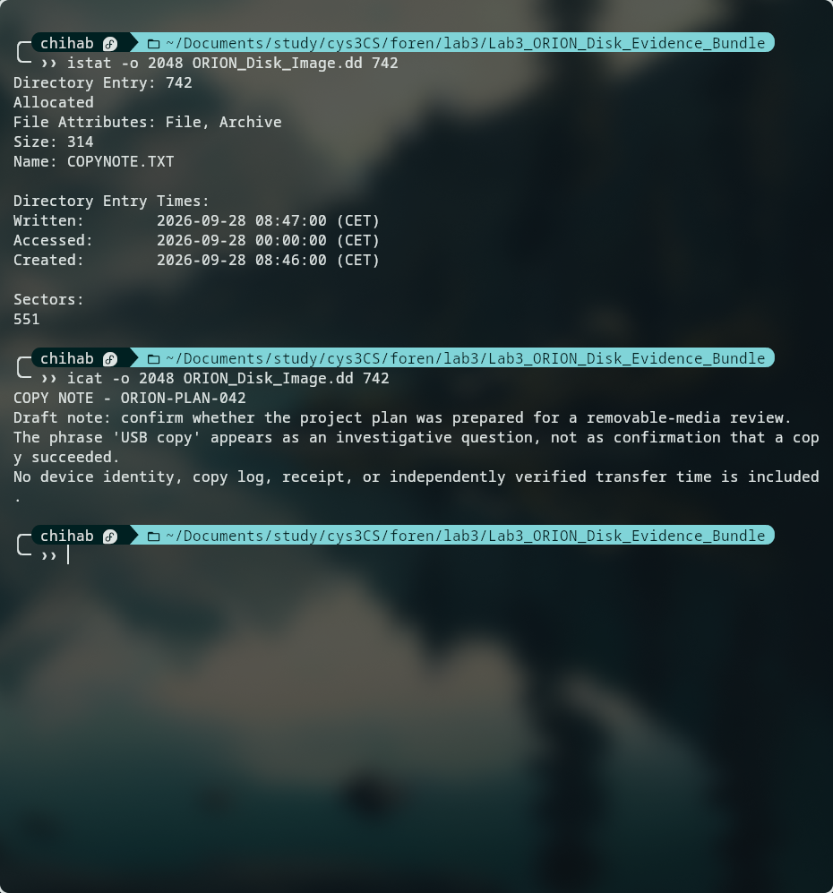

#### 3. File Type Mismatch: ATTACH.JPG
I checked ATTACH.JPG (inode 744, 198 bytes, sector 553):

icat -o 2048 ORION_Disk_Image.dd 744 | file -
icat -o 2048 ORION_Disk_Image.dd 744

* The file has a .JPG extension, but file command identified it as: ASCII text, with CRLF line terminators.
* Content of the file says:
  TRAINING ARTIFACT - NOT A JPEG IMAGE
  This file intentionally has the extension .JPG but contains plain ASCII text.
  Use file-type identification, not the extension alone, to describe its content.
* This proves that we cannot just trust file extensions, we have to look at the actual magic bytes / headers of the file.

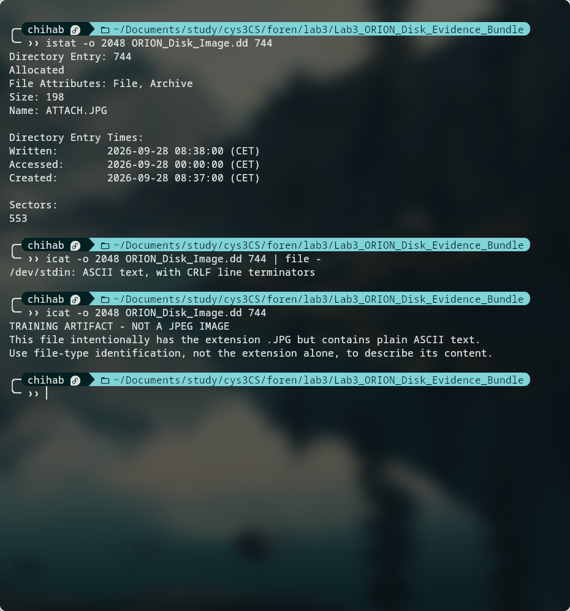

#### Evidence Summary Table

| Path | Inode | Size | Stated Ext | Real File Type | Modified Time (UTC) | Sectors |
| :--- | :--- | :--- | :--- | :--- | :--- | :--- |
| /README.TXT | 4 | 363 B | .TXT | ASCII text | 2026-09-28 07:10:00 | 545 |
| /CASEINFO.TXT | 5 | 354 B | .TXT | ASCII text | 2026-09-28 07:30:00 | 546 |
| /ACTIVITY.CSV | 6 | 479 B | .CSV | ASCII text | 2026-09-28 08:20:00 | 547 |
| /PROJECTS/BOARDPLA.TXT | 741 | 1227 B | .TXT | ASCII text | 2026-09-28 07:42:00 | 548, 549, 550 |
| /PROJECTS/COPYNOTE.TXT | 742 | 314 B | .TXT | ASCII text | 2026-09-28 07:47:00 | 551 |
| /PROJECTS/MEETING.TXT | 743 | 213 B | .TXT | ASCII text | 2026-09-28 08:05:00 | 552 |
| /PROJECTS/ATTACH.JPG | 744 | 198 B | .JPG | ASCII text (Mismatch!) | 2026-09-28 07:38:00 | 553 |
| /PROJECTS/_SBPLAN.TXT | 745 | 160 B | .TXT | ASCII text (Deleted) | 2026-09-28 07:44:00 | 554 |

---

### Task C — Deleted-File Analysis

To find deleted files, I ran fls with the -d option in the /PROJECTS directory:

fls -o 2048 -p -d ORION_Disk_Image.dd 7

Output:
r/r * 745:    PROJECTS/_SBPLAN.TXT

* In FAT filesystems, when a file is deleted, the first byte of its directory entry is replaced with 0xE5 (which shows as _ in TSK). The cluster chain is freed in the FAT, but the metadata and starting cluster pointer stay there until overwritten. The original name was USBPLAN.TXT.
* Using istat -o 2048 ORION_Disk_Image.dd 745, the status is Not Allocated, size is 160 bytes, and it starts at sector 554.
* I recovered the file using icat -o 2048 ORION_Disk_Image.dd 745:
  ORION-PLAN-042 - REMOVABLE STORAGE DRAFT
  This deleted training file is a draft planning note.
  No successful transfer or recipient device is documented here.
* Was it recovered? Yes.
* Is it complete? Yes, completely recovered. The file is only 160 bytes and fits in one single cluster/sector (sector 554), which was never overwritten.
* Does it prove transfer? No, the text specifically states that no transfer or recipient device is documented.

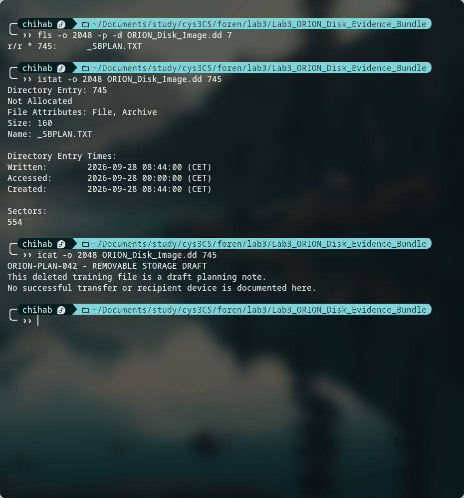

---

### Task D — Timeline Analysis

I created a timeline using fls to dump a body file and mactime to sort it by time:

fls -o 2048 -r -m "" ORION_Disk_Image.dd > bodyfile.txt
mactime -b bodyfile.txt -z UTC 2026-09-01

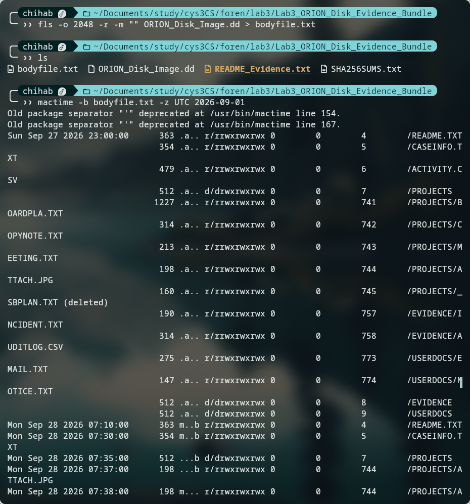

To see only the project and case files clearly, I filtered the output:

mactime -b bodyfile.txt -z UTC 2026-09-01 | grep -E "PROJECTS|README|CASEINFO"

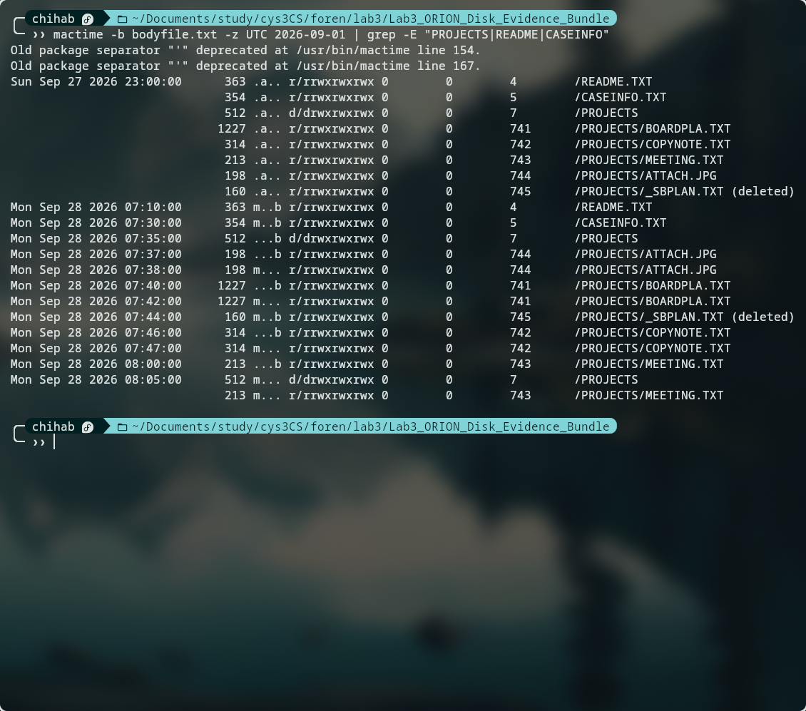

#### Chronological Sequence of Events (in UTC):
1. 07:10:00 UTC: README.TXT was created and written
2. 07:30:00 UTC: CASEINFO.TXT was created and written
3. 07:35:00 UTC: /PROJECTS folder was created
4. 07:37:00 UTC: ATTACH.JPG was created (modified at 07:38:00)
5. 07:40:00 UTC: BOARDPLA.TXT was created (modified at 07:42:00)
6. 07:44:00 UTC: _SBPLAN.TXT (the deleted file) was created and written/deleted
7. 07:46:00 UTC: COPYNOTE.TXT was created (modified at 07:47:00)
8. 08:00:00 UTC: MEETING.TXT was created (modified at 08:05:00)

#### Timestamp Limitations on FAT16:
* No Time Zone: FAT filesystems store dates and times in local time without any timezone offset (no UTC offset). The UTC times shown above are converted because I passed -z UTC to mactime. The disk itself does not tell us what the real timezone of the machine was.
* Resolution: Creation time has 10 ms resolution, Modified time has 2 seconds resolution, and Accessed time only stores the date (the time part is always 00:00:00).

---

### Conclusion / Findings

1. Were project plan files found on the drive?
   Yes. BOARDPLA.TXT is present and active, and _SBPLAN.TXT was recovered from unallocated space.
2. Was ATTACH.JPG an image?
   No. It is an ASCII text file disguised with a .JPG extension.
3. Did someone copy the files to an external USB drive?
   Unproven. There are no USB device logs, serial numbers, or transfer receipts anywhere in the filesystem. Both BOARDPLA.TXT and COPYNOTE.TXT explicitly state that the text inside does not prove a transfer occurred.
4. Can we identify the person responsible?
   Unproven. FAT16 does not track user accounts or permissions, so it is impossible from this image alone to know who created or copied the files.
