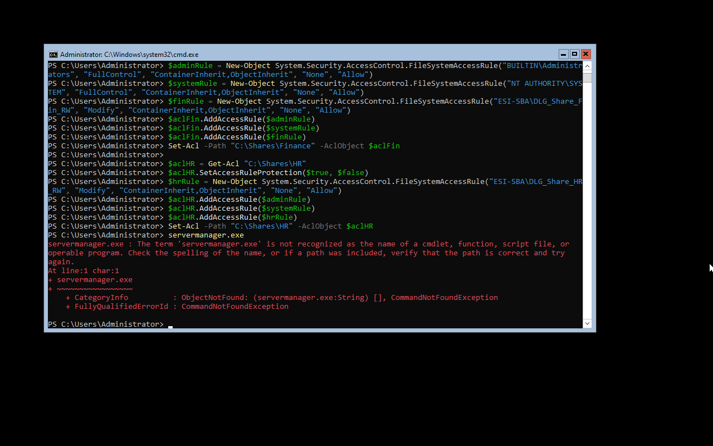
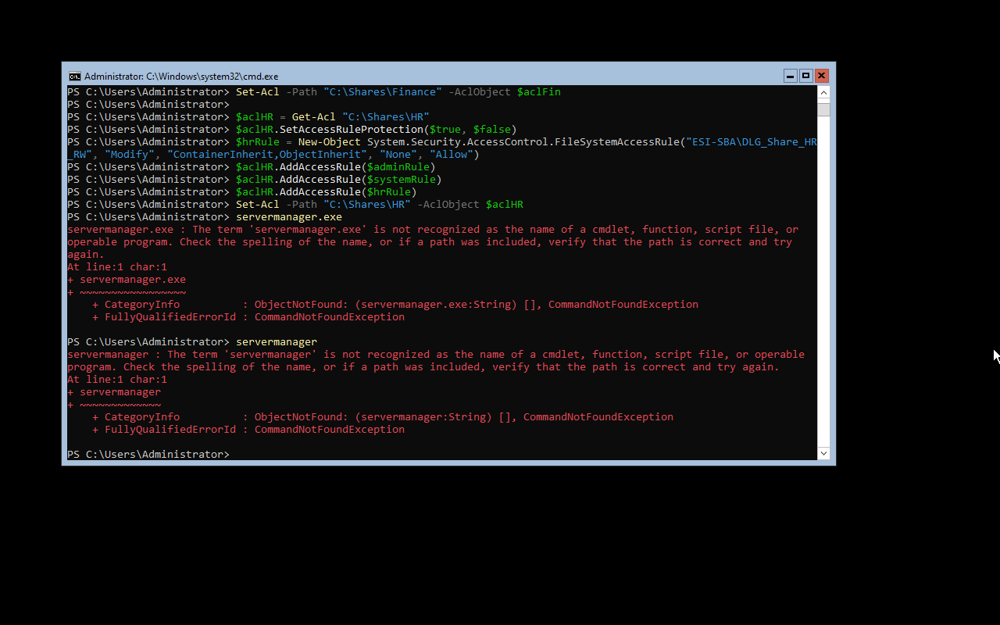
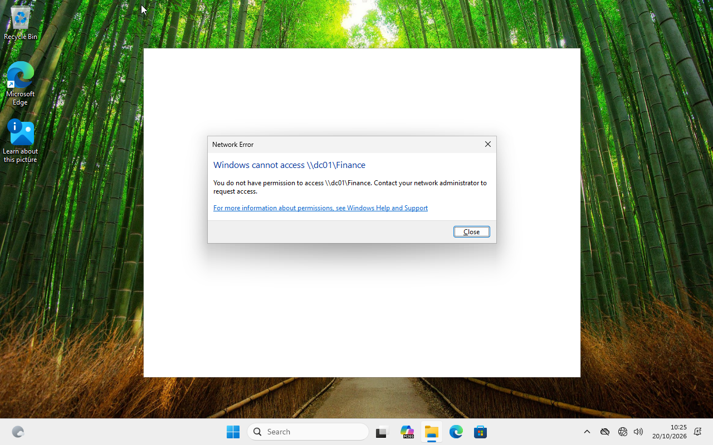
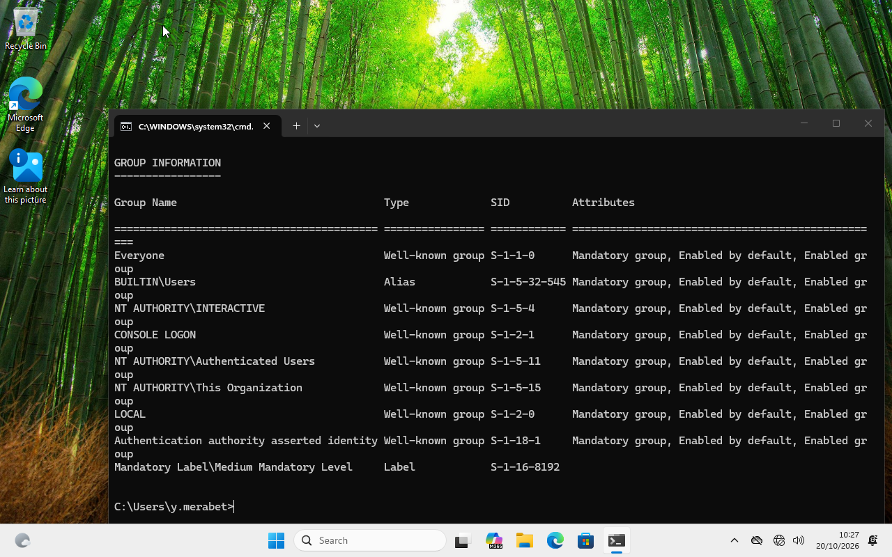
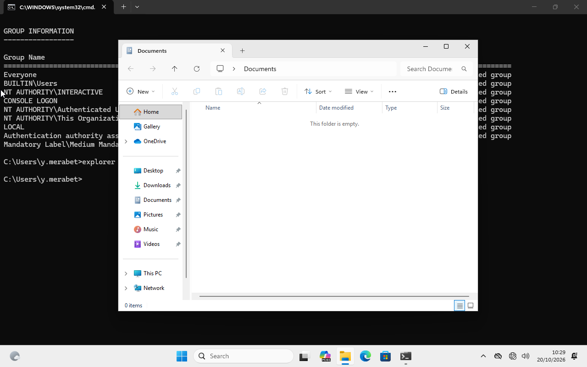
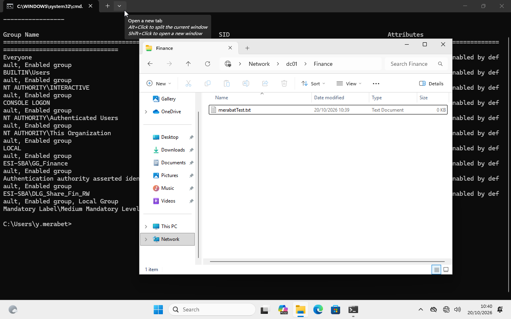
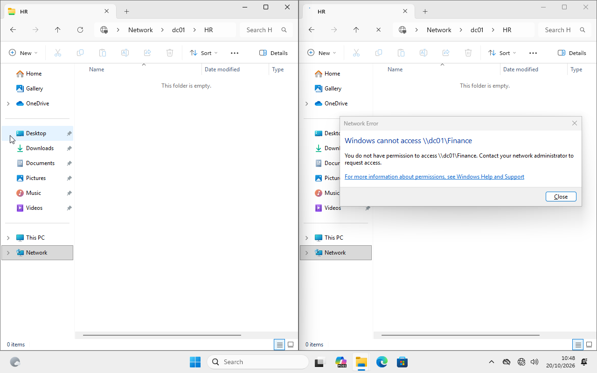
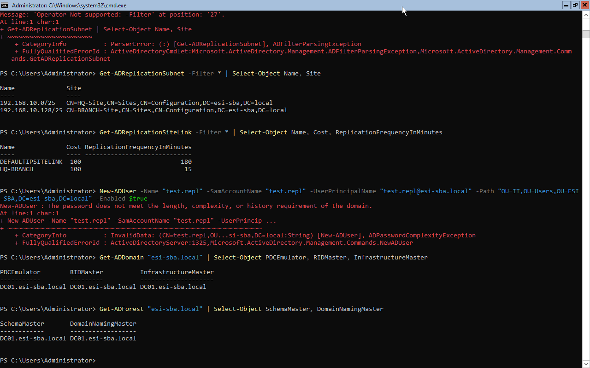
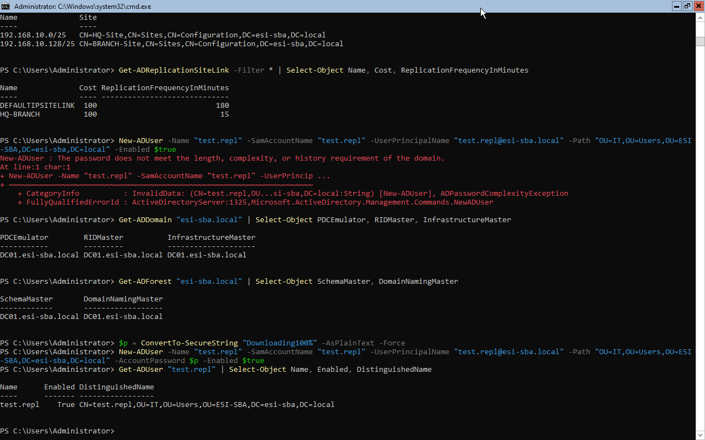

# Lab Report: Directory Services with Active Directory (Lab 1)
**Course:** Identity and Access Management (IAM)  
**Institution:** Higher School of Computer Science Sidi Bel Abbès (ESI-SBA)  
**Date:** October 20, 2026  
**Environment:** Linux KVM / QEMU (`virsh`), Windows Server 2022 Standard (`DC01`), Windows 11 Pro (`CLIENT01`)  
**Network Subnet:** `LAB-NET` (`192.168.10.0/24`) on isolated bridge `virbr1`  

---

## 1. Executive Summary & Lab Objectives
The purpose of this laboratory is to design, deploy, and validate enterprise-grade Directory Services using Microsoft Active Directory Domain Services (AD DS). This lab covers:
1. Setting up the forest root domain controller (`DC01` for `esi-sba.local`) with integrated DNS, Reverse Lookup Zones, and the Active Directory Recycle Bin.
2. Structuring identities using the **AGDLP** (Accounts -> Global Groups -> Domain Local Groups -> Permissions) role-based access control paradigm.
3. Delegating administrative privileges (Help Desk password reset) using Active Directory Access Control Entries (ACEs) on Organizational Units (OUs).
4. Creating enterprise SMB network shares (HR and Finance) with restrictive ACLs tied strictly to Domain Local groups.
5. Demonstrating and analyzing **Scenario A**: Kerberos ticket evaluation, PAC group extraction, token persistence across logon sessions, and security principle inheritance.
6. Enforcing security and desktop baselines using **Group Policy Objects (GPOs)**.
7. Configuring multi-site replication architecture (**HQ-Site** and **BRANCH-Site**) with custom subnets, site links, and FSMO role inspection.

---

## 2. Infrastructure & Topology Overview

### 2.1 Virtual Machines & Network Plan

| VM Name | Hostname | Operating System | IP Address | Netmask | Preferred DNS | Role in Lab |
| :--- | :--- | :--- | :--- | :--- | :--- | :--- |
| `dc01` | `DC01` | Windows Server 2022 Standard | `192.168.10.10` | `255.255.255.0` | `127.0.0.1` | Primary Domain Controller, AD DS, DNS, GC, FSMO Master |
| `win11-lab` | `CLIENT01` | Windows 11 Pro | `192.168.10.50` | `255.255.255.0` | `192.168.10.10` | Domain-joined client workstation |
| Host Bridge | `virbr1` | Linux Bridge (`lab-net`) | `192.168.10.1` | `255.255.255.0` | N/A | Isolated host-only layer-2 virtual switch |

---

## 3. Phase 1 — Forest Root Deployment (`DC01.esi-sba.local`)

### 3.1 Network, Hostname, and Timezone Configuration
- **Hostname:** Configured as `DC01`.
- **IP Settings:** Static IPv4 `192.168.10.10/24`, Gateway: none, DNS: `127.0.0.1`.
- **Time Zone:** Set to `(UTC+01:00) West Central Africa` (`W. Central Africa Standard Time`) to ensure Kerberos timestamp synchronization within the 5-minute skew window.

### 3.2 AD DS Installation & Promotion
- Installed the AD DS role:
  ```powershell
  Install-WindowsFeature -Name AD-Domain-Services -IncludeManagementTools
  ```
- Promoted server to the first Domain Controller of a new forest:
  - **Root Domain:** `esi-sba.local`
  - **NetBIOS Name:** `ESI-SBA`
  - **Functional Level:** Windows Server 2016
  - **DNS Server & Global Catalog (GC):** Enabled

### 3.3 Integrated DNS Reverse Lookup Zone & AD Recycle Bin
- Configured forest-wide replicated reverse lookup zone for `192.168.10.0/24`:
  ```powershell
  Add-DnsServerPrimaryZone -NetworkId "192.168.10.0/24" -ReplicationScope "Forest" -DynamicUpdate "Secure"
  ```
- Enabled the Active Directory Recycle Bin for `esi-sba.local`:
  ```powershell
  Enable-ADOptionalFeature 'Recycle Bin Feature' -Scope ForestOrConfigurationSet -Target 'esi-sba.local' -Confirm:$false
  ```

#### Visual Verification (Phase 1):

*Figure 1: DC01 Local Server settings, network parameters, and domain controller state.*


*Figure 2: Active Directory Domain Services and DNS operational status on DC01.*

---

## 4. Phase 2 — Organizational Structure & AGDLP Identity Architecture

### 4.1 Organizational Unit (OU) Hierarchy
The directory was structured with accidental deletion protection:
- `OU=ESI-SBA,DC=esi-sba,DC=local`
  - `OU=Users` (containing `OU=IT`, `OU=HR`, `OU=Finance`)
  - `OU=Admins`
  - `OU=Groups`
  - `OU=Workstations`
  - `OU=Servers`
  - `OU=ServiceAccounts`
  - `OU=Disabled`

### 4.2 Group Design (AGDLP)
- **Global Groups (`GG_*`)**: Created in `OU=Groups` to represent departmental memberships:
  - `GG_IT`
  - `GG_HR`
  - `GG_Finance`
  - `GG_Helpdesk`
- **Domain Local Groups (`DLG_*`)**: Created in `OU=Groups` to assign resource access:
  - `DLG_Share_HR_RW`
  - `DLG_Share_Fin_RW`
- **Nesting**:
  - `GG_Finance` -> member of `DLG_Share_Fin_RW`
  - `GG_HR` -> member of `DLG_Share_HR_RW`

### 4.3 User Accounts
| Account | OU Path | Global Group | Administrative / Lab Role |
| :--- | :--- | :--- | :--- |
| `a.benali` | `OU=IT,OU=Users,OU=ESI-SBA,...` | `GG_IT` | IT Systems Engineer (Daily user) |
| `k.meziane` | `OU=IT,OU=Users,OU=ESI-SBA,...` | `GG_Helpdesk` | Help Desk Technician |
| `s.khelifi` | `OU=HR,OU=Users,OU=ESI-SBA,...` | `GG_HR` | Human Resources Officer |
| `m.haddad` | `OU=Finance,OU=Users,OU=ESI-SBA,...` | `GG_Finance` | Senior Accountant |
| `y.merabet` | `OU=Finance,OU=Users,OU=ESI-SBA,...` | *(None initially)* | New Accountant (Subject of Scenario A) |
| `adm-a.benali`| `OU=Admins,OU=ESI-SBA,...` | `Domain Admins` | Dedicated Domain Administrator Account |

### 4.4 Help Desk Delegation of Control
Delegated password reset permissions over all standard user accounts in `OU=Users,OU=ESI-SBA,DC=esi-sba,DC=local` to `GG_Helpdesk`:
- **Extended Right:** `User-Force-Change-Password` (`{00299570-246d-11d0-a768-00aa006e0529}`)
- **Inheritance:** Descendant `User` objects (`{bf967aba-0de6-11d0-a285-00aa003049e2}`).

---

## 5. Phase 3 — SMB Shares, Client Join & Scenario A Analysis

### 5.1 Shared Folders and NTFS ACLs
Created two secure shares on `DC01`:
1. `C:\Shares\Finance` (Share: `Finance`):
   - Inheritance disabled, default permissions stripped.
   - `BUILTIN\Administrators`: Full Control
   - `NT AUTHORITY\SYSTEM`: Full Control
   - `ESI-SBA\DLG_Share_Fin_RW`: Modify / Read / Write
2. `C:\Shares\HR` (Share: `HR`):
   - `BUILTIN\Administrators`: Full Control
   - `NT AUTHORITY\SYSTEM`: Full Control
   - `ESI-SBA\DLG_Share_HR_RW`: Modify / Read / Write

### 5.2 Workstation Domain Join (`CLIENT01`)
- Configured static IP `192.168.10.50/24` with DNS pointing to `192.168.10.10`.
- Joined `CLIENT01` to `esi-sba.local` using administrative credentials `ESI-SBA\adm-a.benali`.
- Moved computer object `CN=CLIENT01,CN=Computers,...` to `OU=Workstations,OU=ESI-SBA,DC=esi-sba,DC=local`.

---

### 5.3 Scenario A: From Denied Access to Granted Access

This scenario traces the identity lifecycle of accountant **`y.merabet`** who initially possessed an account without group memberships.

```
       [ Account Created: y.merabet ]
                     │
                     ▼
          [ Attempt \\dc01\Finance ] ───────► RESULT: ACCESS DENIED (Error 0x80070005)
                     │                                (Token lacks DLG_Share_Fin_RW)
                     ▼
      [ Added y.merabet -> GG_Finance ]
                     │
                     ▼
        [ Same Session Check: whoami ] ──────► RESULT: GG_Finance ABSENT in token
        [ Retry \\dc01\Finance       ] ──────► RESULT: STILL DENIED (Cached Kerberos TGT)
                     │
                     ▼
      [ Purge Tickets & Re-logon / Reboot ]
                     │
                     ▼
        [ New Session Check: whoami  ] ──────► RESULT: ESI-SBA\GG_Finance PRESENT
        [ Access \\dc01\Finance      ] ──────► RESULT: GRANTED! (Created merabetTest.txt)
```

#### Step 1: Before Group Membership (Access Denied)
When `y.merabet` attempts to open `\\dc01\Finance`, Windows denies access:


*Figure 3: Initial access attempt to \\dc01\Finance by y.merabet resulting in "Windows cannot access \\dc01\Finance - You do not have permission".*

#### Step 2: Token Inspection Before Re-logon
Running `whoami /groups` proves that the user's logon security token does not contain `GG_Finance` or `DLG_Share_Fin_RW`:


*Figure 4: whoami /groups on CLIENT01 showing lack of department global group membership in active token.*

#### Step 3: Access Attempt in Same Session (Still Denied)
Even after `Add-ADGroupMember -Identity GG_Finance -Members y.merabet` was run on `DC01`, the active session on `CLIENT01` continues to be denied because the cached Kerberos Ticket-Granting Ticket (TGT) has not been refreshed:


*Figure 5: Re-testing \\dc01\Finance in the same logon session fails due to existing Kerberos PAC token cache.*

#### Step 4: Access Granted After New Logon Session
After logging off and signing back in, a new Kerberos TGT and PAC were generated with the new group memberships. `whoami /groups` now reflects `ESI-SBA\GG_Finance` and `ESI-SBA\DLG_Share_Fin_RW`, and the folder opens with full write permissions:


*Figure 6: whoami /groups showing ESI-SBA\GG_Finance & ESI-SBA\DLG_Share_Fin_RW, with \\dc01\Finance accessible and test file merabetTest.txt created.*

#### Results Matrix
| Moment | `\\dc01\Finance` Access | `GG_Finance` in `whoami /groups` | Effective Access on `DC01` |
| :--- | :--- | :--- | :--- |
| **Before Group Membership** | ❌ **Denied** (Dialog error) | ❌ Absent | None (Traverse / List denied) |
| **After Group Membership (Same Session)** | ❌ **Denied** | ❌ Absent | ✅ Read / Write / Modify |
| **After New Logon Session** | ✅ **Granted** (File created) | ✅ **Present** (`ESI-SBA\GG_Finance`) | ✅ Read / Write / Modify |

---

### 5.4 Phase 3.4 — Departmental Isolation & Opposite Checks
To confirm security boundaries, `s.khelifi` (HR department) logged onto `CLIENT01`:
- **`\\dc01\HR`**: Opened successfully.
- **`\\dc01\Finance`**: Denied with Windows permission error.


*Figure 7: Dual validation test under user s.khelifi: \\dc01\HR opened successfully on the left, \\dc01\Finance denied on the right.*

---

## 6. Phase 4 — Group Policy Configuration

Two enterprise GPOs were created and linked to `OU=Users,OU=ESI-SBA,DC=esi-sba,DC=local`:
1. **`GPO_U_Wallpaper`**:
   - Deployed central wallpaper to `\\esi-sba.local\NETLOGON\esi-sba-wallpaper.jpg`.
   - Applied via `HKCU\Software\Microsoft\Windows\CurrentVersion\Policies\System\Wallpaper`.
2. **`GPO_U_Removable_Storage`**:
   - Enforced restriction `HKCU\Software\Policies\Microsoft\Windows\RemovableStorageDevices\Deny_All = 1`.
   - Blocks unauthorized USB mass storage devices across all department users.

---

## 7. Phase 5 — Multi-Site Replication Topology & FSMO Architecture

### 7.1 Active Directory Sites & Services Configuration
To mirror a distributed enterprise network with a remote branch office:
- **Default Site Renamed:** `Default-First-Site-Name` -> **`HQ-Site`**
- **New Site Created:** **`BRANCH-Site`**
- **Subnet Mappings:**
  - `192.168.10.0/25` -> Associated with `HQ-Site`
  - `192.168.10.128/25` -> Associated with `BRANCH-Site`
- **Inter-Site Link:**
  - Name: `HQ-BRANCH`
  - Included Sites: `HQ-Site`, `BRANCH-Site`
  - Protocol: IP
  - Replication Cost: `100`
  - Replication Frequency: `15 minutes`

### 7.2 Flexible Single Master Operation (FSMO) Role Verification
Active Directory role ownership was verified on `DC01`:
```powershell
Get-ADDomain "esi-sba.local" | Select-Object PDCEmulator, RIDMaster, InfrastructureMaster
Get-ADForest "esi-sba.local" | Select-Object SchemaMaster, DomainNamingMaster
```


*Figure 8: Active Directory Subnets (/25), Site Links (HQ-BRANCH), and FSMO role ownership verified on DC01.*


*Figure 9: User test.repl created in OU=IT to observe directory replication upon branch domain controller addition.*

---

## 8. Conclusion & Next Steps
We have completed the deployment of the Active Directory core services, AGDLP identity hierarchy, network shares with strict ACLs, client onboarding, security policies, and multi-site replication definitions.

Once additional storage space is freed up on the host machine:
- **Phase 5.2 & 5.3:** Deploy `DC02` in `BRANCH-Site`, test intra-site vs. inter-site replication convergence delays, account revocation latency, and DC failover.
- **Phase 6:** Deploy `DC03` (`labri-sba.local`), configure DNS conditional forwarders, establish the one-way forest trust, and validate cross-forest resource access (**Scenario B**).
EOF