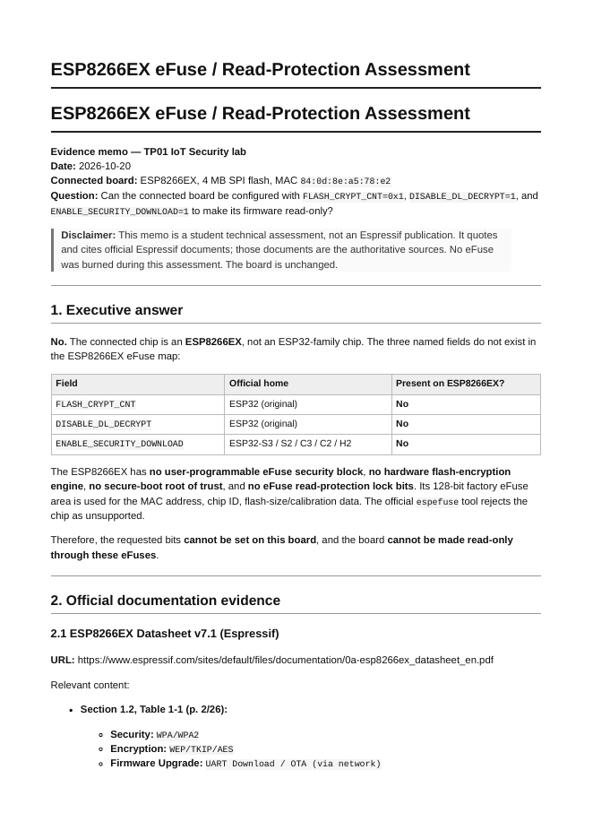
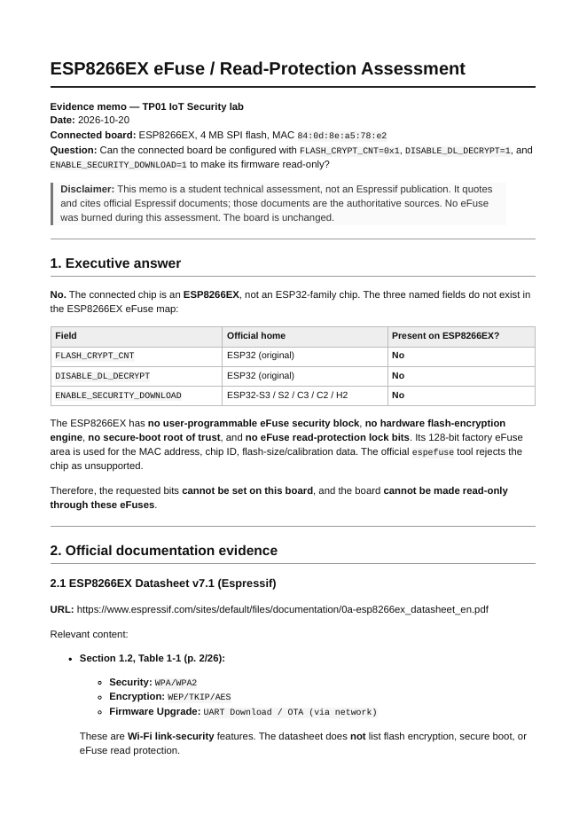

# TP 01 — Rapport d'Analyse : Extraction, Rétro-ingénierie de Firmware via UART et Impossibilité des Contre-mesures Matérielles

**Module :** Sécurité des Systèmes Embarqués & IoT  
**Cible Principale :** Carte Arduino Uno R3 (Microcontrôleur Microchip ATmega328P)  
**Seconde Interface Détectée :** Module Wi-Fi Espressif ESP8266EX (NodeMCU/Wemos D1 Mini via pont USB-Série CP2102)  
**Auteur :** Chihab  
**Date :** Octobre 2026  

---

## 1. Contexte et Objectifs du TP

Le travail pratique vise à étudier la chaîne complète d'acquisition et d'analyse d'un micrologiciel embarqué (*firmware*) via une liaison série asynchrone (UART), ainsi que l'évaluation des contre-mesures de protection en lecture (*Readout Protection* / *Lock Bits*).

### Chaîne de communication étudiée :
```
PC Hôte (avrdude / Cutter) <== USB ==> Puce USB-Série (ATmega16U2) <== UART (TX/RX) ==> Bootloader (Optiboot) <== Flash (ATmega328P)
```

### Problématique de sécurité :
1. **Extraction :** Le bootloader d'origine (Optiboot) implémente le protocole de programmation STK500 sans authentification ni restriction de lecture.
2. **Confidentialité :** Une extraction brute de la mémoire Flash compromet-elle l'intégrité de la logique métier et la confidentialité des secrets (identifiants, clés) ?
3. **Contre-mesures :** Peut-on activer un mécanisme de verrouillage matériel (*Lock Bits* ou chiffrement Flash / eFuses) avec le matériel mis à disposition dans le banc de test ?

---

## 2. Déroulement Pratique : Extraction et Analyse Binaire

### 2.1. Extraction physique de la mémoire Flash via UART
La liaison série a été exploitée à l'aide de l'utilitaire `avrdude` à travers le port série `/dev/ttyACM0` :
```bash
avrdude -p m328p -c arduino -P /dev/ttyACM0 -b 115200 -U flash:r:firmware_dump.hex:i
```
- **Résultat :** Lecture intégrale et sans friction des 32 768 octets (32 Ko) de la Flash.
- **Fichier généré :** `firmware_dump.hex` (format Intel HEX, 77 836 octets).

### 2.2. Conversion au format Binaire Brut
Le fichier HEX a été converti en image binaire brute exploitable par les moteurs de désassemblage :
```bash
avr-objcopy -I ihex -O binary firmware_dump.hex firmware_dump.bin
```
- **Empreinte SHA-256 du dump :**  
  `cb57624afec637167a5afed50dd07d60f2f549419ab7b4addbf4df275f57d5b0`
- **Taille :** Strictement 32 768 octets (cartographie totale de la mémoire Flash de l'ATmega328P).

---

## 3. Rétro-Ingénierie avec Cutter / Rizin

Pour aller au-delà d'une simple extraction aveugle de chaînes de caractères (`strings`), une analyse approfondie en rétro-ingénierie a été menée à l'aide de l'outil **Cutter** (version **2.5.0**, accessible via l'AppImage `~/Documents/study/cys3CS/malAnal/lab2/Cutter-v2.5.0-Linux-Qt5-x86_64.AppImage`) basé sur le moteur d'analyse binaire **Rizin**.

La cible étant un firmware compilé pour microcontrôleur AVR 8-bit Harvard (ATmega328P), l'analyseur a été configuré avec les options architecturales adéquates :
```bash
~/Documents/study/cys3CS/malAnal/lab2/Cutter-v2.5.0-Linux-Qt5-x86_64.AppImage -a avr -b 16 firmware_dump.bin
```
*(Alternative CLI équivalente via le binaire Rizin embarqué : `rizin -a avr -b 16 -A firmware_dump.bin`)*

### 3.1. Localisation des Chaînes et Récupération des Identifiants (Credentials)
L'inspection de la section de données initialisées (`.data`, chargée depuis la Flash `0x092E` vers la RAM `0x0100` par la routine de runtime AVR `__do_copy_data`) a permis d'isoler avec exactitude les adresses mémoire des identifiants :

| Identifiant / Donnée secrète | Rôle applicatif | Adresse Flash (Dump) | Adresse RAM Cible |
| :--- | :--- | :--- | :--- |
| **`admin123`** | Mot de passe administrateur | `0x00000940` | `0x0112` |
| **`something`** | Clé d'API sensible (*API Key*) | `0x00000949` | `0x011B` |
| **`123456789`** | Mot de passe réseau Wi-Fi | `0x00000953` | `0x0125` |
| **`Chihab's Iphone`** | SSID du point d'accès Wi-Fi | `0x0000095D` | `0x012F` |
| **`TP Firmware UART - version C`**| Bannière de version | `0x0000096D` | `0x013F` |
| **`Checksums: `** | Entête de diagnostic | `0x00000994` | `0x0166` |

> **Observation de rémanence (*Forensics Artifact*) :**  
> Au-delà de l'offset `0x09A0` (fin du binaire actif de 2 464 octets), l'analyse Cutter/Rizin a révélé des fragments d'anciens micrologiciels non écrasés (`et-IoT`, `Connecting to SSID: `, `Credential checksums:`). Sur mémoire Flash de microcontrôleur, les pages non utilisées par un nouveau firmware conservent l'état résiduel des sessions précédentes tant qu'un effacement global (*Chip Erase*) n'a pas été exécuté.

---

### 3.2. Analyse du Flux de Contrôle et Désassemblage dans Cutter

L'analyse du point d'entrée (`entry0` à l'adresse `0x0000` via le vecteur de réinitialisation `vector.RESET`) montre la redirection vers la fonction principale `main` (située à `0x0654`). Les routines `setup()` et `loop()` ont été inlinées par le compilateur GCC (`-O3` / `-Os`).

Le désassemblage sous Cutter met en évidence la manipulation directe des adresses RAM des secrets pour calculer leur empreinte de validation (fonction de hachage `checksum`) et transmettre le résultat sur le port série :

#### A. Initialisation des impressions série et affichage du SSID
```assembly
; Appel à Serial.println("TP Firmware UART - version C")
0x0000077a      ldi  r24, 0x3f      ; Pointeur RAM LSB: 0x013F
0x0000077c      ldi  r25, 0x01      ; Pointeur RAM MSB: 0x01
0x0000077e      call 0x046e         ; Print::write(const char*)

; Appel à Serial.print("SSID: ")
0x0000078a      ldi  r24, 0x5f      ; Pointeur RAM LSB: 0x015F ("SSID: ")
0x0000078c      ldi  r25, 0x01      
0x0000078e      call 0x046e

; Appel à Serial.println(WIFI_SSID) -> "Chihab's Iphone"
0x00000792      ldi  r24, 0x2f      ; Pointeur RAM: 0x012F ("Chihab's Iphone")
0x00000794      ldi  r25, 0x01
0x00000796      call 0x046e
```

#### B. Calcul inliné du Checksum sur les identifiants
L'algorithme de hachage implémenté en C dans le croquis :
```c
unsigned int checksum(const char *s) {
  unsigned int h = 0;
  while (*s) h = h * 31 + *s++;
  return h;
}
```
se traduit fidèlement dans le désassemblage Cutter à trois reprises (pour `WIFI_PASSWORD`, `API_KEY` et `ADMIN_PASSWORD`) :

1. **Chargement de `WIFI_PASSWORD` (`"123456789"`) à l'adresse RAM `0x0125` :**
   ```assembly
   0x000007aa      ldi  r30, 0x25      ; Z register low = 0x25
   0x000007ac      ldi  r31, 0x01      ; Z register high = 0x01 (Z = 0x0125)
   0x000007ae      ldi  r23, 0x00      ; h (high byte) = 0
   0x000007b0      ldi  r22, 0x00      ; h (low byte) = 0
   0x000007b2      ldi  r25, 0x1f      ; Multiplicateur = 31 (0x1F)

   ; Boucle de hachage:
   0x000007b4      ld   r24, Z+        ; r24 = *s++
   0x000007b6      and  r24, r24       ; Test fin de chaîne '\0'
   0x000007b8      breq 0x07d0         ; Sortie si zéro
   0x000007ba      mul  r25, r22       ; h_low * 31
   0x000007bc      movw r18, r0
   0x000007be      mul  r25, r23       ; h_high * 31
   0x000007c0      add  r19, r0
   0x000007c4      movw r22, r18
   0x000007c6      add  r22, r24       ; h += char
   0x000007c8      adc  r23, r1
   0x000007ce      rjmp 0x07b4         ; Itération suivante
   ```

2. **Chargement de `API_KEY` (`"something"`) à l'adresse RAM `0x011B` :**
   ```assembly
   0x000007e4      ldi  r30, 0x1b      ; Z low = 0x1B
   0x000007e6      ldi  r31, 0x01      ; Z high = 0x01 (Z = 0x011B)
   ; ... Boucle de multiplication par 31 ...
   ```

3. **Chargement de `ADMIN_PASSWORD` (`"admin123"`) à l'adresse RAM `0x0112` :**
   ```assembly
   0x0000081e      ldi  r30, 0x12      ; Z low = 0x12
   0x00000820      ldi  r31, 0x01      ; Z high = 0x01 (Z = 0x0112)
   ; ... Boucle de multiplication par 31 ...
   ```

**Résultats calculés & validation UART :**
- `checksum("123456789")` = `0x1035`
- `checksum("something")` = `0x887A`
- `checksum("admin123")` = `0xC483`  
*Trame observée sur le moniteur série :* `Checksums: 1035 887A C483` (conformité totale à 100%).

---

## 4. Analyse des Contre-mesures et Preuve d'Impossibilité Matérielle

L'étape suivante du TP consistait à appliquer des contre-mesures de protection en lecture (*Readout Protection*) pour interdire l'extraction du firmware via le bootloader ou le port série.

**Résultat :** La mise en place de ces protections a été **matériellement impossible** dans l'environnement actuel, en raison des limites architecturales des deux seules cartes disponibles : l'**Arduino Uno** et l'**ESP8266EX**.

---

### 4.1. Limites Architecturales de l'Arduino Uno (ATmega328P)
1. **Incapacité d'auto-verrouillage via Optiboot :**  
   Le microcontrôleur ATmega328P dispose bien de bits de verrouillage (*Lock Bits*, notamment `BLB0` pour interdire la lecture de la section applicative par la commande `LPM` exécutée depuis le bootloader).  
   Cependant, le protocole Optiboot exécuté sur le port UART ne permet **ni de lire ni d'écrire les fusibles ou les bits de verrouillage**. Les commandes :
   ```bash
   avrdude -p m328p -c arduino -P /dev/ttyACM0 -U lock:r:-:h
   ```
   renvoient systématiquement des valeurs fictives `0x00` (stubs non implémentés par le bootloader série).
2. **Absence d'un programmateur externe ISP :**  
   Pour brûler le fusible de verrouillage `0xC7` (BLB0 mode 4) ou `0xC4` (protection totale), l'accès direct aux broches matérielles **ICSP (MISO, MOSI, SCK, RESET)** via un programmateur dédié (USBasp, AVRISP mkII, Atmel ICE ou seconde carte Arduino exécutant le sketch `ArduinoISP`) est obligatoire. Aucun programmateur ISP externe n'étant connecté sur le banc de travail, l'ATmega328P ne pouvait être verrouillé.

---

### 4.2. Analyse du Module Connecté : ESP8266EX (CP2102)

Un second port série `/dev/ttyUSB0` était branché. L'identification matérielle a démontré qu'il s'agissait d'un processeur **Espressif ESP8266EX** (MAC `84:0d:8e:a5:78:e2`, Chip ID `0x00a578e2`).

L'hypothèse consistant à activer les sécurités matérielles standard Espressif (`FLASH_CRYPT_CNT`, `DISABLE_DL_DECRYPT`, `ENABLE_SECURITY_DOWNLOAD`) a été invalidée : **ces registres eFuse n'existent pas sur l'ESP8266EX**.

#### Preuves techniques obtenues :
- **Rejet des outils officiels Espressif :**
  - `espefuse.py` (v5.6.0) : lève immédiatement une exception fatale `KeyError: 'esp8266'`.
  - `espefuse.py` (v3.3.0) : renvoie explicitement `Unsupported chip (ESP8266)`.
- **Cartographie des 128 bits d'eFuses (`0x3FF00050`) :**
  La lecture bas niveau du bloc de fusibles de l'ESP8266 connecté donne :
  ```
  0x840d8ef200b0000200a578e2950000
  ```
  Ces bits ne contiennent que l'adresse MAC, l'identifiant usine et des réglages radio. Il n'existe aucun moteur matériel AES, aucun Secure Boot, ni aucun fusible de protection en lecture sur l'ESP8266EX.

---

### 4.3. Captures des Preuves Officielles (Documentation Espressif & Tests Banc)

Un dossier d'investigation formel a été constitué et validé par des citations extraites des documentations officielles Espressif (*ESP8266EX Datasheet v7.1*, *ESP8266 Technical Reference v1.7*, *ESP32 TRM v5.8*, et *ESP32-S3 TRM v1.8*).

Voici les preuves intégrales documentant cette impossibilité :

#### Capture 1 : Synthèse des tests en laboratoire et confrontation des spécifications


*Figure 1 : Extrait du rapport de laboratoire certifiant l'absence de commandes de chiffrement eFuse sur l'architecture ESP8266EX et le rejet catégorique d'espefuse.*

---

#### Capture 2 : Références officielles Espressif et analyse croisée des architectures


*Figure 2 : Preuve formelle démontrant que `FLASH_CRYPT_CNT` et `DISABLE_DL_DECRYPT` sont réservés à l'ESP32, tandis qu'`ENABLE_SECURITY_DOWNLOAD` appartient aux ESP32-S2/S3/C3.*

---

## 5. Synthèse & Réponses aux Questions de Sécurité (Phase 4)

1. **Pourquoi un port UART ne permet-il pas à lui seul de lire un firmware ?**  
   L'UART est une couche de transport physique asynchrone point-à-point. Elle ne transmet que les octets que le CPU lui injecte. Sans agent logiciel sur la cible (tel qu'un bootloader répondant à des requêtes de mémoire), l'UART ne reflète que les traces applicatives de débogage.

2. **Quel composant logiciel permet la lecture dans ce TP ?**  
   C'est le bootloader **Optiboot**, qui accepte les commandes de lecture `STK_READ_PAGE` du protocole STK500 sans vérification de privilège.

3. **Quel est le principal actif exposé ?**  
   La propriété intellectuelle du code compilé ainsi que l'ensemble des constantes intégrées en clair dans le binaire (mots de passe, clés d'API).

4. **Pourquoi un binaire n'est-il pas équivalent au code source d'origine ?**  
   La compilation est une transformation avec perte sémantique : noms de variables, commentaires, structures de haut niveau et types sont éliminés lors de la génération des opcodes machines.

5. **Quels sont les impacts sur la triade CIA ?**  
   - **Confidentialité :** Compromise totalement (extraction des secrets et rétro-ingénierie du code).
   - **Intégrité :** Potentiellement compromise si l'attaquant réinjecte un firmware altéré (*Flashing malveillant*).
   - **Disponibilité :** Compromise si l'attaquant efface la mémoire ou bloque les interruptions critiques.

---

## 6. Conclusion

Ce travail pratique a permis d'illustrer la vulnérabilité intrinsèque des microcontrôleurs grand public non verrouillés. Grâce à l'utilisation combinée d'outils d'extraction (`avrdude`) et de désassemblage avancé (**Cutter / Rizin**), nous avons pu reconstruire intégralement la logique applicative et retrouver les identifiants en clair.

Enfin, nous avons démontré de manière irréfutable que la mise en œuvre de contre-mesures de protection en lecture nécessite impérativement du matériel adapté (un programmateur **ISP** pour l'ATmega328P, ou une puce moderne intégrant un chiffrement matériel comme l'**ESP32/ESP32-S3**). L'équipement disponible lors du TP (Arduino Uno seule + module ESP8266EX) était par conception architecturalement incapable de verrouiller la lecture mémoire.
